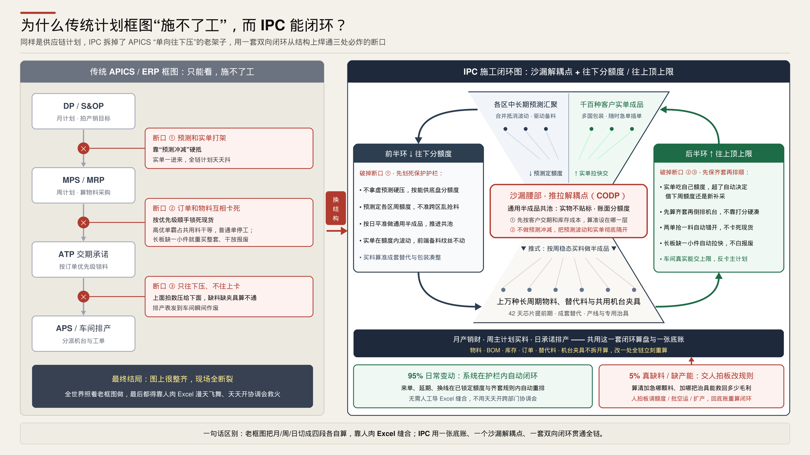
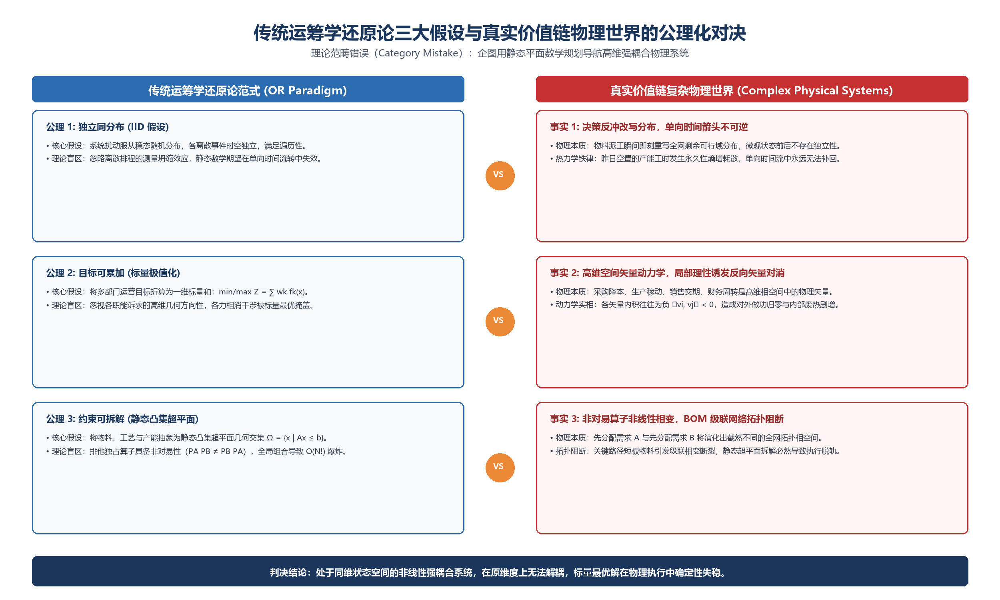

# 系统与复杂性科学 & 价值链物理学：秩序的生成、存续与进化
## Systems & Complexity Science & Value Chain Physics: The Generation, Persistence, and Evolution of Order
### —— 开放复杂巨系统的公理化形式证明、多项式可计算定理与超大规模工业闭环实证

**作者 / Author：**  

**孟凡淳 (Grit Meng)**  
价值链物理学、系统与复杂性科学独立学者 | IPC 智能计划与控制引擎缔造者  
前联想全球供应链集成计划方案（IPS）系统负责人兼总设计师  

**Grit Meng**  
Independent Scholar in Value Chain Physics and Systems & Complexity Science | Creator of the Intelligent Planning & Control (IPC) Engine  
Former Head & Chief Architect, Integrated Planning Solution (IPS), Lenovo Global Supply Chain  

[_%7C_Non--Commercial_Eval_(Code)_%7C_No_Patent_Grant-b03a2e?style=flat-square)](LICENSE)
[](https://papers.ssrn.com/sol3/papers.cfm?abstract_id=7640758)
[%20%E2%88%88%20P-2ea043?style=flat-square)](docs/Formal%20Proof%20of%20%27Living%20Expression%27%20and%20%27Self-Consistent%20Computability%27%20in%20Open%20Complex%20Giant%20Systems.pdf)
[-d29922?style=flat-square)](docs/Value%20Chain%20Physics%20——%20Formal%20Proof%20of%20Open%20Complex%20Giant%20Systems%20and%20Full-Domain%20Computability%20Based%20on%20Non-IID%20Dynamics.pdf)
[](https://github.com/GritMeng/Value-Chain-Physics/tree/main/ipc-core-benchmark)
[-0969da?style=flat-square)](https://github.com/GritMeng/Value-Chain-Physics/tree/main/ipc-core-benchmark)
[](https://github.com/GritMeng/Value-Chain-Physics/tree/main/ipc-core-benchmark)
[](https://gritmeng.github.io/Value-Chain-Physics/demo/)

**官方门户 / Official Portal：** [https://gritmeng.github.io/Value-Chain-Physics/](https://gritmeng.github.io/Value-Chain-Physics/)  
**联系邮箱 / Email：** gritmeng@outlook.com  

---

## 一图看懂：为什么传统计划框图“施不了工”，而 IPC 能闭环？



> **多终端高清直取**：[横屏完整施工对比版（16:9 高清 PNG）](images/ipc_vs_apics_blueprint.png) · [横屏矢量源图（SVG）](images/ipc_vs_apics_blueprint.svg) · [手机竖屏大字适配版（免放大直读 PNG）](images/ipc_vs_apics_mobile.png) ｜ [**打开免安装在线交互沙盘亲手试算 (`demo/`)**](https://gritmeng.github.io/Value-Chain-Physics/demo/)

---

## 8 集实机演示与可复现验证索引 (8-Episode Live Demos & Open Verification Map)

面向制造业管理者、供应链架构师与运筹学同行，以下 8 个核心场景均已打通 **“80 秒实机演示视频 ➔ 浏览器免安装亲手改数 ➔ 本地 C++17 源码一键压测”** 三重验真路径（视频高清版统一归档于仓库 [GitHub Releases (`v1.0-video-demos`)](https://github.com/GritMeng/Value-Chain-Physics/releases)）：

| 集数 | 核心工业场景与批判靶心 | 关键定量实证结论 | 免安装在线试算 (`demo/`) | 可下载复现 C++17 目标 |
| :---: | :--- | :--- | :---: | :--- |
| **EP01** | **两单抢一料（排序耦合死锁）**：为何预测 100% 准，现有 SCP / APS 仍会卡死现货？ | 2 需求 × 3 物料现场改数：现有系统现货白等 5 天且普通单延期，IPC 错开锁料双单零延期、白等降至 1 天 | [场景 1](https://gritmeng.github.io/Value-Chain-Physics/demo/) | [`test_delivery_precision`](ipc-core-benchmark/benchmarks/test_delivery_precision.cpp) |
| **EP02** | **成套组替代（11,000 元长板 vs 1,000 元短板）**：为何系统自己算出一大半呆滞？ | 100 套原本只需再掏 10 万拉快小料（总成本 120 万、呆滞归零），现有系统却迫使重买整套掏 120 万并憋死 110 万长板（总成本 230 万，白白多亏 110 万） | [场景 2](https://gritmeng.github.io/Value-Chain-Physics/demo/) | [`test_substitution_rules`](ipc-core-benchmark/benchmarks/test_substitution_rules.cpp) |
| **EP03** | **推拉解耦点（CODP）选址与改工艺账**：设在哪一层最省钱？ | 两道非补偿硬门槛 + 沙漏裸机共池：安全库存直降 50.0%、资金省 62.5%，旧工艺早镭雕一键算出改工艺立省 32 万 | [场景 3](https://gritmeng.github.io/Value-Chain-Physics/demo/) | [`test_codp_positioning`](ipc-core-benchmark/benchmarks/test_codp_positioning.cpp) |
| **EP04** | **彻底废除“预测冲减”**：日度平准切额度 + 超额三态自动分流 | 周保护额度按日平准切开防首日独占；超额按 `Mode A / B / C` 自动决定借下周额度或触发新补采，消除计划抖动 | [场景 4](https://gritmeng.github.io/Value-Chain-Physics/demo/) | [`test_push_pull_router`](ipc-core-benchmark/benchmarks/test_push_pull_router.cpp) |
| **EP05** | **多供方按份额分单 + 最小包装（MPQ）凑整不超买** | 1,000 颗按 `50:30:20` 与每盘 300 颗凑整：现有系统各自凑整超买 200 颗呆滞，IPC 逐轮重算精准守恒 1,000 颗（改 1,400 照样零超买） | [场景 5](https://gritmeng.github.io/Value-Chain-Physics/demo/) | [`test_substitution_rules`](ipc-core-benchmark/benchmarks/test_substitution_rules.cpp) |
| **EP06** | **One Plan 企业级全局闭环与两阶段推拉排产**：预测备通用半成品过产能齐套 + 实单守配额承诺不爽约 | 普通笔记本实跑 300 万级需求控制塔（核心计算 2.74 秒）；跨解耦点两阶段推拉排产消除传统静态后道提前期 550 台爽约违约 | [场景 7](https://gritmeng.github.io/Value-Chain-Physics/demo/) | [`test_two_stage_iop_network`](ipc-core-benchmark/benchmarks/test_two_stage_iop_network.cpp) |
| **EP07** | **不完全替代与 30% 混用红线**：主料缺料陷阱与国别认证硬拦截 | 主料断料仅齐套 500 台时，现有系统硬派 300 颗副料致占比飙至 37.5% 违约；IPC 按主料锚定截断 214 颗（29.97%），认证不符直接归零 | [场景 6](https://gritmeng.github.io/Value-Chain-Physics/demo/) | [`test_substitution_rules`](ipc-core-benchmark/benchmarks/test_substitution_rules.cpp) |
| **EP08** | **极限性能与全网先序区间秒级展开**：50 万笔需求 × 200 万物料 × 20 层价值链网络（DAG） | 真实构建 `L0..L19` 20 层 425 万条共享 BOM 边 + 200 万节点先序区间 `[rank..end]` $O(1)$ 子树查询：核心算子约 **262 ms** · 峰值内存 **254 MB** · 守恒残差 **0.00** | [场景 8](https://gritmeng.github.io/Value-Chain-Physics/demo/) | [`stress_benchmark_2m`](ipc-core-benchmark/benchmarks/stress_benchmark_2m.cpp) |

> **性能三档口径透明说明**：`262.57 ms`（EP08）为本仓开源纯内存 C++17 核心算子耗时（拓扑排序 + 20 层级联消纳 + 50 万需求防波堤，不含磁盘 I/O 与复杂排程约束）；控制塔 `2.74 秒`（EP06）为 300 万级真实数据库内存引擎 5 阶段耗时（含 326 万行磁盘读写全落盘为 `9.62 秒`）；作者在公众号与《管理视野》等文章中提及的 `296 秒` 为含完整企业数据加载、15 万项不等式约束求解与全链路落盘的工业级端到端实测。

---

## 🏛️ 从第一性原理到超大规模工业闭环的四层研究架构 (Four-Layer Research & Engineering Architecture)

本门户完整呈现开放复杂巨系统（Open Complex Giant Systems, OCGS）从**元科学公理形式化**、**微观死锁机理证明**、**千亿级跨国制造网络 18 年纵向实证**到 **C++17 裸金属开源算子基准**的端到端研究与工程闭环：

| 研究与工程层级 | 核心科学问题与系统边界 | 形式化原理与数学结论 | 实证基准与可复现验证入口 |
| :--- | :--- | :--- | :--- |
| **I. 元科学公理层**<br>*(Axiomatic Foundations)* | 强耦合非独立同分布（Non-IID）开放复杂巨系统为何不可还原、如何生成并存续秩序？ | 确立五阶认知主干（定性八论 $\to$ 闭环可计算 $\to$ 界内最优 $\to$ 秩序 $\to$ 五维心智）与五维双螺旋流形（$S = \mathcal{M}_{\text{model}} \otimes \mathcal{A}$），证明五维最小完备性、因果深度有限性（$K < +\infty$）与时空残差三阶统一定理 | SSRN [`7251098`](https://papers.ssrn.com/sol3/papers.cfm?abstract_id=7251098) · [`7557878`](https://papers.ssrn.com/sol3/papers.cfm?abstract_id=7557878) · [`7496118`](https://papers.ssrn.com/sol3/papers.cfm?abstract_id=7496118) · [`7557899`](https://papers.ssrn.com/sol3/papers.cfm?abstract_id=7557899) · [`7451920`](https://papers.ssrn.com/sol3/papers.cfm?abstract_id=7451920) · [三部曲纲领 PDF](docs/元科学体系三部曲全息架构纲领_公理_活体_投影.pdf) |
| **II. 六大原创定律层**<br>*(Six Foundational Laws)* | 复杂巨系统的实体流形、排序锁死、认知内耗、组合爆炸、残差归因与治理心智如何构成闭环？ | 二十四字总纲：**五维完备、排序耦合、认知对消、正交剪枝、因果残差、良知制动**——6 部独立中英双语形式化证明单行本，全部补齐显式定理（`Q.E.D.`）与波普尔可证伪判据 | SSRN [`7751519`](https://papers.ssrn.com/sol3/papers.cfm?abstract_id=7751519) · [`7640758`](https://papers.ssrn.com/sol3/papers.cfm?abstract_id=7640758) · [`7688779`](https://papers.ssrn.com/sol3/papers.cfm?abstract_id=7688779) · [`7704718`](https://papers.ssrn.com/sol3/papers.cfm?abstract_id=7704718) · [`7751598`](https://papers.ssrn.com/sol3/papers.cfm?abstract_id=7751598) · [六大定律总纲 PDF](docs/孟氏六大原创定律总纲_6字4词标准冠名与全息导读.pdf) |
| **III. 工业实证层**<br>*(Longitudinal Validation)* | 多项式闭环可计算定理（$T(N) = O(K \cdot N \log N) \in \mathbf{P}$）能否在超大规模真实离散制造网络中长期自治运行？ | **联想集团全球供应链（2008–2026）18 年底层执行闭环实证**与独立通用 **IPC 引擎**：覆盖 **500,000 需求订单、20 层 BOM、2,000,000 物料节点、150,000 不等式约束**，实现 **>95% 人在环外（HOOTL）闭环运行** | SSRN [`7442100`](https://papers.ssrn.com/sol3/papers.cfm?abstract_id=7442100) · [中文 PDF](docs/价值链物理学：基于非独立同分布（Non-IID）的开放复杂巨系统形式化证明与全域可计算性研究.pdf) · [EN PDF](docs/Value%20Chain%20Physics%20——%20Formal%20Proof%20of%20Open%20Complex%20Giant%20Systems%20and%20Full-Domain%20Computability%20Based%20on%20Non-IID%20Dynamics.pdf) |
| **IV. 算子与复现代码层**<br>*(Reproducible Benchmarks)* | 如何在单台普通电脑上消除多阶 BOM 与替代料组合爆炸，并零随机性复现五维心智制动仿真？ | CPU 裸金属 SoA 连续内存调度与零堆内存回滚（50 万需求协同耗时 **< 45 ms**）+ 五维心智隐蔽相变蒙特卡洛零依赖复现脚本（`N=1,000, T=80, BASE_SEED=42`） | [`ipc-core-benchmark/`](https://github.com/GritMeng/Value-Chain-Physics/tree/main/ipc-core-benchmark)（C++17 源码 + 双发验证器）· [`scripts/reproduce_5d_mind_mc.py`](scripts/reproduce_5d_mind_mc.py) · **20 项强耦合发明专利矩阵** |

---

## 📐 最小完备反例推演：2 需求 × 3 物料 × 4 周期 (Minimal Counterexample: 2 Demands × 3 Materials × 4 Periods)

为排除外部随机扰动与数据噪音，以下给出共享资源网络在 **100% 预测准确、100% 数据完备** 确定性条件下的最小完备推演基准（详见《排序耦合定律》第 2 节）：

* **需求与 BOM 结构**：
  * 高优先级订单 $D_1$（权重 $w_1 = 10$）：需 1 单位专用件 $M_1$ + 1 单位通用件 $M_2$；
  * 普通优先级订单 $D_2$（权重 $w_2 = 1$）：需 1 单位通用件 $M_2$ + 1 单位专用件 $M_3$。
* **确定性供给到达序列**（4 个离散周期 $t \in \{1, 2, 3, 4\}$）：
  * 通用件 $M_2$：$t = 1$ 在手现货 1 单位，$t = 3$ 预计到货 1 单位；
  * $D_2$ 专用件 $M_3$：$t = 2$ 预计到货 1 单位（故 $D_2$ 物理齐套下界为 $t = 2$）；
  * $D_1$ 专用件 $M_1$：$t = 4$ 预计到货 1 单位（故 $D_1$ 物理齐套下界为 $t = 4$）。

| 治理机制 | 周期 $t=1$ 资源分配动作 | 周期 $t=2$ 交付状态 | 周期 $t=3 \sim 4$ 最终结果 | 物理与运营后果 |
| :--- | :--- | :--- | :--- | :--- |
| **传统静态优先级排他锁库**<br>*(Static Priority Pegging)* | $D_1$ 凭高优先级排他锁定 $M_2(t=1)$，但因缺 $M_1(t=4)$ 无法开工 | $M_3(t=2)$ 到货，但 $M_2(t=1)$ 被 $D_1$ 闲置霸占，$D_2$ 被迫断料停工 | $M_2(t=3)$ 被迫改配给已延期的 $D_2$；$D_1$ 于 $t=4$ 交付 | **$D_2$ 无故延期**，$M_2(t=1)$ 产生 3 个周期无效呆滞库存，完美输入生成双输死锁 |
| **两阶段正交解耦治理**<br>*(Two-Stage Orthogonal Governance)* | **第一阶段 $O(N)$**：穿透 BOM 计算物理齐套水位包络（$T_{D_2}^{\min}=2, T_{D_1}^{\min}=4$） | **第二阶段 $O(N \log N)$**：按水位重排，$M_2(t=1)$ 配给 $D_2$，**$D_2$ 于 $t=2$ 准时交付** | $M_2(t=3)$ 与 $M_1(t=4)$ 精准汇合，**$D_1$ 于 $t=4$ 准时交付** | **零延期、零呆滞锁库**，在不损伤 $D_1$ 交期的前提下实现严格帕累托改进 |



---

## 🖥️ 免安装在线交互验证与开源复现入口 (Interactive Sandbox & Reproducible Benchmarks)

除 12 部中英双语形式化论著 PDF 外，本门户提供以下零依赖在线交互验证沙盘与本地开源复现入口（点击直接打开）：

| 验证入口 | 核心能力与复现边界 | 访问路径 |
| :--- | :--- | :--- |
| **1. IPC 八大无菌交互验证沙盘（免安装实测）** | 8 大可调参数无菌沙盘（两单抢一料死锁 2×3、缺一小件拉快盘活整套 1.1 万 vs 1 千、推拉解耦点选址与库存省钱、不做预测冲减按额度平准与超额分流、多供方按比例分单与包装凑整、不完全替代高配代低配与 30% 红线、两阶段推拉排产不爽约、全网先序区间展开与反查），实时对比现有 SCP / APS 与 IPC | [**打开免安装交互验证沙盘 (`demo/index.html`)**](https://gritmeng.github.io/Value-Chain-Physics/demo/) |
| **2. C++17 七套件开源压测与 Python 双发对账** | 单机无 GPU 跑穿 500,000 需求 × 20 层 BOM × 2,000,000 节点先序区间索引（核心算子 262.57 ms），支持本地直接编译运行与交叉校验 | [查看源码与编译指南 (`ipc-core-benchmark/`)](https://github.com/GritMeng/Value-Chain-Physics/tree/main/ipc-core-benchmark) |
| **3. 五维心智与良知制动蒙特卡洛复现脚本** | 隐蔽规则相变下五棒串联非补偿木桶极小值与碳硅正交耦合仿真（`N=1,000, T=80, BASE_SEED=42`，零第三方依赖） | [查看复现脚本 (`scripts/reproduce_5d_mind_mc.py`)](scripts/reproduce_5d_mind_mc.py) |

---

## 🧭 全景导读：双通道阅读指引 (Dual-Track Reading Guide)

针对不同专业背景的读者，建议按以下两条路径切入：

> [!TIP]
> * **🏭 通道 A（面向制造企业决策者、供应链架构师、工业工程与运筹学学者 —— 从“六大定律与工业实证”切入）**：  
>   请先阅读上方 **最小完备反例推演** 与下方 **第一部分：孟氏六大原创定律**（推荐从 **第 2 篇《排序耦合定律》** 与 **六大原创定律总纲导读** 切入），看清传统 S&OP 与 MRP/APS 死锁的生成机制，以及为什么企业各项运营 KPI 并非独立零和权衡（Not Trade-offs），而是同一物理耦合态的不同切面。随后阅读 **第 7 篇《价值链物理学》** 及文末 **C++17 百万级节点求解基准**。
> * **🏛️ 通道 B（面向系统科学、复杂性科学、AI 与认知科学学者 —— 从“元科学公理与可计算性”切入）**：  
>   请按 **五阶认知主干** 与下方 **第二部分（第 8 篇 $\to$ 第 12 篇）** 顺序阅读：**范式导论**（《第二次文艺复兴》）$\longrightarrow$ **公理母算法**（《秩序的生成、存续与进化》）$\longrightarrow$ **动力学可计算证明**（《活体表达与闭环可计算性》）$\longrightarrow$ **Non-IID 与钱学森 OCGS 同构证明**（《开放复杂巨系统的生成、存续与进化》）$\longrightarrow$ **主体认知底座**（《良知驱动的五维心智模型》及 [`scripts/reproduce_5d_mind_mc.py`](scripts/reproduce_5d_mind_mc.py) 复现实验）。

---

## 📚 官方学术论著全集 (12 Authorized Bilingual Treatise Suites + 2 Guides)

本门户收录的 **12 部核心中英双语形式化证明论著**（6 部原创定律单行本 + 6 部元科学总论篇）及 **2 份体系导读总纲** 均采用专著形式化证明体例与全集统一数学符号，提供离线 Pandoc AST 编译的 **中文版 PDF** 与 **英文版 PDF**（其中 **11 部英文论著**已完成 Elsevier SSRN 预印本登记与最新版同步）：

### 🔥 第一部分：孟氏六大原创定律（24 字总纲：五维完备 · 排序耦合 · 认知对消 · 正交剪枝 · 因果残差 · 良知制动）

* 🧭 **总纲导读 PDF**：[孟氏六大原创定律总纲_6字4词标准冠名与全息导读.pdf](docs/孟氏六大原创定律总纲_6字4词标准冠名与全息导读.pdf)

#### 1. [本体与流形基底] 《五维完备定律：开放复杂巨系统的最小完备基底与涌现单向不可逆原理》 (SSRN 7751519)
* **核心内容**：严格证明任何闭环可计算应然系统须具备 $\mathcal{M}_{\text{model}}=\langle \mathcal{N},\mathcal{T},\mathcal{C},X,\Delta X\rangle$ 五维最小完备正交基底（定理 1），并证明由高维业务本体向表层流程与控制塔大屏的映射为非单射有损投影（$\nexists \Pi_{\text{proj}}^{-1}$，定理 2），故抄流程、抄大屏与“业务提需求+IT写代码”在数学上不可逆。
* 🇨🇳 **中文版 PDF**：[五维完备定律：开放复杂巨系统的最小完备基底与涌现单向不可逆原理.pdf](docs/五维完备定律：开放复杂巨系统的最小完备基底与涌现单向不可逆原理.pdf)
* 🇬🇧 **英文版 PDF**：[The_Law_of_5D_Completeness.pdf](docs/The_Law_of_5D_Completeness.pdf)
* 🔗 **SSRN 官方预印本**：[SSRN Abstract 7751519](https://papers.ssrn.com/sol3/papers.cfm?abstract_id=7751519)

#### 2. ⭐ [微观机理与正交解耦] 《排序耦合定律：共用资源网络中静态优先级跨期锁死与 KPI 耦合原理》 (SSRN 7640758)
* **核心内容**：通过“2 需求、3 物料”无菌最小模型证明优先级—齐套期倒挂确定性交叉错配（定理 1）与保交期承诺软让渡严格帕累托占优（定理 2），揭示企业 KPI 是一体多面的物理耦合态，并给出联想 18 年两阶段 $\mathcal{O}(N) + \mathcal{O}(K \cdot N \log N)$ 正交解耦实证。
* 🇨🇳 **中文版 PDF**：[排序耦合定律：产销协同中KPI冲突的生成机制与正交治理.pdf](docs/排序耦合定律：产销协同中KPI冲突的生成机制与正交治理.pdf)
* 🇬🇧 **英文版 PDF**：[The Law of Sequencing Coupling —— Genesis Mechanism and Orthogonal Governance of KPI Conflicts in S&OP.pdf](docs/The%20Law%20of%20Sequencing%20Coupling%20——%20Genesis%20Mechanism%20and%20Orthogonal%20Governance%20of%20KPI%20Conflicts%20in%20S&OP.pdf)
* 🔗 **SSRN 官方预印本**：[SSRN Abstract 7640758](https://papers.ssrn.com/sol3/papers.cfm?abstract_id=7640758)

#### 3. [内耗与界内驻值] 《认知对消定律：复杂系统中认知内耗废热的生成机制与走通即最优正交收敛证明》 (SSRN 7688779)
* **核心内容**：建立三源损耗分解 $W_{\text{loss}}^{\text{total}}(S\mid\Pi_k)=W_{\text{intrinsic}}(\mathcal{C}_{\text{hard}})+\Delta W_{\text{hidden}}(S\mid\Pi_k)+\Delta W_{\text{heat}}^{\text{explicit}}(S\mid\Pi_k)$，在同量纲逐维非负抵消项上实现无跨维主观权重判零，严格证明单调邻域 $\Omega_{\text{mono}}(\Pi_k)$ 内的最小对冲驻值下界与合取先验严格字典序 $\prec_{\text{lex}}$ 下的唯一执行轨线（定理 1）。
* 🇨🇳 **中文版 PDF**：[认知对消定律：复杂系统中认知内耗废热的生成机制与走通即最优正交收敛证明.pdf](docs/认知对消定律：复杂系统中认知内耗废热的生成机制与走通即最优正交收敛证明.pdf)
* 🇬🇧 **英文版 PDF**：[The_Law_of_Cognitive_Cancellation.pdf](docs/The_Law_of_Cognitive_Cancellation.pdf)
* 🔗 **SSRN 官方预印本**：[SSRN Abstract 7688779](https://papers.ssrn.com/sol3/papers.cfm?abstract_id=7688779)

#### 4. [复杂度坍缩与建造律] 《正交剪枝定律：广延流与刚性容量分步消纳及对偶建造原理》 (SSRN 7704718)
* **核心内容**：揭示 $\mathcal{O}(N!)$ 组合爆炸源于将可跨期存续的广延流与过时作废的刚性容量混入同一矩阵；基于正离散时钟同拍无环 DAG、一阶前向持久化不变式与整数缺口势函数严格单调递减，证明两阶段正交剪枝实现多项式闭环可计算 $T_{\text{step}}(N)=\mathcal{O}(K\cdot N\log N)\in\mathbf{P}$（定理 1）与双向对偶建造原理。
* 🇨🇳 **中文版 PDF**：[正交剪枝定律：广延流与刚性容量分步消纳及对偶建造原理.pdf](docs/正交剪枝定律：广延流与刚性容量分步消纳及对偶建造原理.pdf)
* 🇬🇧 **英文版 PDF**：[The_Law_of_Orthogonal_Pruning.pdf](docs/The_Law_of_Orthogonal_Pruning.pdf)
* 🔗 **SSRN 官方预印本**：[SSRN Abstract 7704718](https://papers.ssrn.com/sol3/papers.cfm?abstract_id=7704718)

#### 5. [闭环归因与修宪] 《因果残差定律：携带因果血缘的残差对偶回溯与二阶修宪判决原理》 (SSRN 7751598)
* **核心内容**：证明无血缘标量误差映射具有非平凡核空间而无法逆推故障源头，依托带因果血缘残差 $\Delta X_{\text{residual}} = X_{\text{real}} \ominus X_{\text{plan}}$ 建立 $\mathcal{O}(K)$ 对偶二元完备可判定理（定理 1），精准区分一阶硅基自愈与二阶碳基修宪 $\Phi: \text{Boundary}_k \overset{\Delta X}{\longrightarrow} \text{Boundary}_{k+1}$。
* 🇨🇳 **中文版 PDF**：[因果残差定律：携带因果血缘的残差对偶回溯与二阶修宪判决.pdf](docs/因果残差定律：携带因果血缘的残差对偶回溯与二阶修宪判决.pdf)
* 🇬🇧 **英文版 PDF**：[The_Law_of_Causal_Residual.pdf](docs/The_Law_of_Causal_Residual.pdf)
* 🔗 **SSRN 官方预印本**：[SSRN Abstract 7751598](https://papers.ssrn.com/sol3/papers.cfm?abstract_id=7751598)

#### 6. [主体制动与碳硅共生] 《良知制动定律：二阶重界五维心智的非补偿性木桶极小值与碳硅张量共生原理》
* **核心内容**：以 Popoviciu 不等式证明快慢双时间尺度良知制动与紧支撑方差截断定理（定理 1）及五棒串联门控非补偿性木桶极小值定理（定理 2），贯通生物脑有限高势垒至外化硅基硬联锁死区极限，配套零依赖蒙特卡洛复现脚本 [`scripts/reproduce_5d_mind_mc.py`](scripts/reproduce_5d_mind_mc.py)。
* 🇨🇳 **中文版 PDF**：[良知制动定律：二阶重界五维心智的非补偿性木桶极小值与碳硅张量共生原理.pdf](docs/良知制动定律：二阶重界五维心智的非补偿性木桶极小值与碳硅张量共生原理.pdf)
* 🇬🇧 **英文版 PDF**：[The_Law_of_Conscience_Braking.pdf](docs/The_Law_of_Conscience_Braking.pdf)

---

### 🏛️ 第二部分：系统与复杂性科学元科学总论体系 (Meta-Science of Open Complex Giant Systems)

* 🧭 **三部曲架构纲领 PDF**：[元科学体系三部曲全息架构纲领_公理_活体_投影.pdf](docs/元科学体系三部曲全息架构纲领_公理_活体_投影.pdf)

#### 7. ⭐ [工业实证总纲 · 投影篇] 《价值链物理学：基于非独立同分布（Non-IID）的形式化证明与全域可计算性》 (SSRN 7442100)
* **核心内容**：将公理与活体闭环投影至离散制造价值网络，完成 Non-IID 病理诊断、矢量对消废热定理、五维双螺旋正交剪枝架构及钱学森开放复杂巨系统（OCGS）三大原则的形式化证明，完整呈现联想集团（2008–2026）18 年底层执行闭环与通用 IPC 引擎（50 万需求、20 层 BOM、200 万物料节点、15 万约束，单机 296 秒）的工业实证。
* 🇨🇳 **中文版 PDF**：[价值链物理学：基于非独立同分布（Non-IID）的开放复杂巨系统形式化证明与全域可计算性研究.pdf](docs/价值链物理学：基于非独立同分布（Non-IID）的开放复杂巨系统形式化证明与全域可计算性研究.pdf)
* 🇬🇧 **英文版 PDF**：[Value Chain Physics —— Formal Proof of Open Complex Giant Systems and Full-Domain Computability Based on Non-IID Dynamics.pdf](docs/Value%20Chain%20Physics%20——%20Formal%20Proof%20of%20Open%20Complex%20Giant%20Systems%20and%20Full-Domain%20Computability%20Based%20on%20Non-IID%20Dynamics.pdf)
* 🔗 **SSRN 官方预印本**：[SSRN Abstract 7442100](https://papers.ssrn.com/sol3/papers.cfm?abstract_id=7442100)

#### 8. [范式导论] 《第二次文艺复兴：为什么系统与复杂性科学是“科学的科学”》 (SSRN 7557899)
* **核心内容**：系统审视 400 年笛卡尔-牛顿还原论的适用边界，阐明在万物强耦合（Non-IID）时代，系统与复杂性科学为何从分支学科跃升为统摄自然科学与社会科学的“科学的科学（Science of Sciences）”。
* 🇨🇳 **中文版 PDF**：[第二次文艺复兴：为什么系统与复杂性科学是“科学的科学”.pdf](docs/第二次文艺复兴：为什么系统与复杂性科学是“科学的科学”.pdf)
* 🇬🇧 **英文版 PDF**：[The Second Renaissance —— Why Systems and Complexity Science Is the 'Science of Sciences'.pdf](docs/The%20Second%20Renaissance%20——%20Why%20Systems%20and%20Complexity%20Science%20Is%20the%20%27Science%20of%20Sciences%27.pdf)
* 🔗 **SSRN 官方预印本**：[SSRN Abstract 7557899](https://papers.ssrn.com/sol3/papers.cfm?abstract_id=7557899)

#### 9. [公理篇 · 母算法] 《系统与复杂性科学：秩序的生成、存续与进化 —— 开放复杂巨系统的统御原理》 (SSRN 7251098)
* **核心内容**：确立“无观察者则无世界；无序一经划界，即立显为应然秩序”的第一性原理，构建生序、存序、进序三大公理，先验划界 $\Pi$、刚性流形 $\Pi_\perp$、带血缘残差 $\Delta X_{\text{residual}}$（残差范数 $\Delta(t)$）、二阶元认知修宪 $\Phi$ 四大算子，以及首尾相接的“定性八论”与可证伪边界。
* 🇨🇳 **中文版 PDF**：[系统与复杂性科学：秩序的生成、存续与进化 —— 开放复杂巨系统的统御原理.pdf](docs/系统与复杂性科学：秩序的生成、存续与进化%20——%20开放复杂巨系统的统御原理.pdf)
* 🇬🇧 **英文版 PDF**：[Systems and Complexity Science —— The Generation, Persistence, and Evolution of Order — The Governing Principles of Open Complex Giant Systems.pdf](docs/Systems%20and%20Complexity%20Science%20——%20The%20Generation,%20Persistence,%20and%20Evolution%20of%20Order%20—%20The%20Governing%20Principles%20of%20Open%20Complex%20Giant%20Systems.pdf)
* 🔗 **SSRN 官方预印本**：[SSRN Abstract 7251098](https://papers.ssrn.com/sol3/papers.cfm?abstract_id=7251098)

#### 10. [活体篇 · 动力学证明] 《开放复杂巨系统的“活体表达”与“闭环可计算性”》 (SSRN 7557878)
* **核心内容**：将母算法凝练为“划界相对律 + 闭环可计算 + 元认知再划界”的活体闭环；严格证明五维流形最小完备性（定理 1.1）、多项式闭环可计算性 $T(N) = \mathcal{O}(K \cdot N \log N) \in \mathbf{P}$（定理 2.1）、单调邻域 $\Omega_{\text{mono}}(\Pi_k)$ 内“走通 $\wedge$ 显性零对消 $\wedge$ 先验字典序 $\iff$ 界内最小对冲驻值与唯一确定性轨线 $\exists! S_k^*$”（命题 2.2）及三阶统一定理。
* 🇨🇳 **中文版 PDF**：[开放复杂巨系统的“活体表达”与“闭环可计算性”.pdf](docs/开放复杂巨系统的“活体表达”与“闭环可计算性”.pdf)
* 🇬🇧 **英文版 PDF**：[Formal Proof of 'Living Expression' and 'Self-Consistent Computability' in Open Complex Giant Systems.pdf](docs/Formal%20Proof%20of%20%27Living%20Expression%27%20and%20%27Self-Consistent%20Computability%27%20in%20Open%20Complex%20Giant%20Systems.pdf)
* 🔗 **SSRN 官方预印本**：[SSRN Abstract 7557878](https://papers.ssrn.com/sol3/papers.cfm?abstract_id=7557878)

#### 11. [同构篇 · Non-IID 推演] 《开放复杂巨系统的生成、存续与进化 —— 基于 Non-IID 第一性原理的推论推演与 OCGS 同构证明》 (SSRN 7496118)
* **核心内容**：以非独立同分布（Non-IID）作为万物强耦合的数学基石，系统推演计算不可约性、人脑带宽死锁与矢量对消的生成机制，并严格证明五维双螺旋架构（$S \equiv \mathcal{M}_{\text{model}} \otimes \mathcal{A}$）与钱学森 OCGS 总体设计部、综合集成研讨厅、人机结合三大原则的拓扑同构性。
* 🇨🇳 **中文版 PDF**：[开放复杂巨系统的生成、存续与进化 —— 基于 Non-IID 第一性原理的推论推演与 OCGS 同构证明.pdf](docs/开放复杂巨系统的生成、存续与进化%20——%20基于%20Non-IID%20第一性原理的推论推演与%20OCGS%20同构证明.pdf)
* 🇬🇧 **英文版 PDF**：[Generation, Survival, and Evolution of Open Complex Giant Systems —— Inference Deductions and Isomorphic Proof of OCGS Based on the Non-IID First Principle.pdf](docs/Generation,%20Survival,%20and%20Evolution%20of%20Open%20Complex%20Giant%20Systems%20——%20Inference%20Deductions%20and%20Isomorphic%20Proof%20of%20OCGS%20Based%20on%20the%20Non-IID%20First%20Principle.pdf)
* 🔗 **SSRN 官方预印本**：[SSRN Abstract 7496118](https://papers.ssrn.com/sol3/papers.cfm?abstract_id=7496118)

#### 12. [主体篇 · 心智底座] 《良知驱动的五维心智模型：重新定义问题与认知外推》 (SSRN 7451920)
* **核心内容**：构建主体侧五棒严格串联神经控制机芯 $\langle R_{\text{sens}}, E_{\text{supp}}, S_{\text{buff}}, A_{\text{fluid}}, \Omega_{\text{meta}} \rangle$，回答“什么样的人与碳硅总体设计部能完成二阶问题重定义”，配套 4 幅 300-DPI 双语架构图与确定性蒙特卡洛复现脚本 [`scripts/reproduce_5d_mind_mc.py`](scripts/reproduce_5d_mind_mc.py)。
* 🇨🇳 **中文版 PDF**：[良知驱动的五维心智模型：重新定义问题与认知外推 —— 兼论复杂巨系统总设计师的心智画像与破局机制.pdf](docs/良知驱动的五维心智模型：重新定义问题与认知外推%20——%20兼论复杂巨系统总设计师的心智画像与破局机制.pdf)
* 🇬🇧 **英文版 PDF**：[Conscience-Driven Five-Dimensional Mind Model —— Problem Redefinition and Cognitive Extrapolation in Open Complex Giant Systems.pdf](docs/Conscience-Driven%20Five-Dimensional%20Mind%20Model%20——%20Problem%20Redefinition%20and%20Cognitive%20Extrapolation%20in%20Open%20Complex%20Giant%20Systems.pdf)
* 🔗 **SSRN 官方预印本**：[SSRN Abstract 7451920](https://papers.ssrn.com/sol3/papers.cfm?abstract_id=7451920)

---

## 🏛️ Elsevier SSRN 预印本平台官方确权总表 (SSRN Author Dashboard)

作者在 Elsevier SSRN 预印本平台已登记并同步最新版（`2026-11-25`）**11 部**核心学术论著（另第 12 部《良知制动定律》已完成本地定稿并开放 PDF 直下）：

| 体系板块 | SSRN ID | 论文英文标题 (Scholarly Paper Title) | 当前状态 | 官方直达链接 |
| :--- | :--- | :--- | :--- | :--- |
| **第一定律（本体）** | **SSRN 7751519** | *The Law of 5D Completeness: Minimal Complete Basis and Irreversible Emergence Principle in OCGS* | **PRELIMINARY_UPLOAD** | [View on SSRN](https://papers.ssrn.com/sol3/papers.cfm?abstract_id=7751519) |
| **第二定律（机理）** | **SSRN 7640758** | *The Law of Sequencing Coupling: Genesis Mechanism and Orthogonal Governance of KPI Conflicts in S&OP* | **DISTRIBUTED** | [View on SSRN](https://papers.ssrn.com/sol3/papers.cfm?abstract_id=7640758) |
| **第三定律（内耗）** | **SSRN 7688779** | *The Law of Cognitive Cancellation: Genesis Mechanism of Cognitive Internal Friction and Orthogonal Convergence* | **APPROVED** | [View on SSRN](https://papers.ssrn.com/sol3/papers.cfm?abstract_id=7688779) |
| **第四定律（剪枝）** | **SSRN 7704718** | *The Law of Orthogonal Pruning: Polynomial Computability of Two-Stage Extensive-Intensive Resolution* | **APPROVED** | [View on SSRN](https://papers.ssrn.com/sol3/papers.cfm?abstract_id=7704718) |
| **第五定律（残差）** | **SSRN 7751598** | *The Law of Causal Residual: Dual Retrograde Attribution of Lineage-Bearing Residuals and Second-Order Judgment* | **PRELIMINARY_UPLOAD** | [View on SSRN](https://papers.ssrn.com/sol3/papers.cfm?abstract_id=7751598) |
| **第六定律（主体）** | *Preprint PDF* | *The Law of Conscience Braking: Non-Compensatory Minimum of the 5D Mind and Carbon-Silicon Symbiosis* | **PDF LIVE** | [Open PDF](docs/The_Law_of_Conscience_Braking.pdf) |
| **工业实证总纲** | **SSRN 7442100** | *Value Chain Physics: Formal Proof of Open Complex Giant Systems and Full-Domain Computability* | **DISTRIBUTED** | [View on SSRN](https://papers.ssrn.com/sol3/papers.cfm?abstract_id=7442100) |
| **范式导论** | **SSRN 7557899** | *The Second Renaissance: Why Systems and Complexity Science Is the "Science of Sciences"* | **DISTRIBUTED** | [View on SSRN](https://papers.ssrn.com/sol3/papers.cfm?abstract_id=7557899) |
| **公理篇（母算法）** | **SSRN 7251098** | *Systems and Complexity Science: The Generation, Persistence, and Evolution of Order* | **DISTRIBUTED** | [View on SSRN](https://papers.ssrn.com/sol3/papers.cfm?abstract_id=7251098) |
| **活体篇（可计算）** | **SSRN 7557878** | *Formal Proof of 'Living Expression' and 'Self-Consistent Computability' in Open Complex Giant Systems* | **DISTRIBUTED** | [View on SSRN](https://papers.ssrn.com/sol3/papers.cfm?abstract_id=7557878) |
| **同构篇（Non-IID）** | **SSRN 7496118** | *Generation, Survival, and Evolution of Open Complex Giant Systems: Non-IID & OCGS Isomorphism* | **DISTRIBUTED** | [View on SSRN](https://papers.ssrn.com/sol3/papers.cfm?abstract_id=7496118) |
| **主体篇（心智模型）** | **SSRN 7451920** | *Conscience-Driven Five-Dimensional Mind Model: Problem Redefinition and Cognitive Extrapolation* | **DISTRIBUTED** | [View on SSRN](https://papers.ssrn.com/sol3/papers.cfm?abstract_id=7451920) |

---

## 💻 开源可审计算子与 200 万物料求解基准 (IPC Core Open Benchmark)

为向学界与工业界验证**“500,000 需求订单、20-level BOM、2,000,000 物料节点的毫秒/分钟级正交求解”与“>95% 人在环外闭环”在物理与数学上的可复现性**，本仓库开放了脱敏后的 C++17 核心算法算子与基准压测套件 [`ipc-core-benchmark/`](https://github.com/GritMeng/Value-Chain-Physics/tree/main/ipc-core-benchmark)，支持本地直接编译运行与交叉对账：

| 核心算子模块 | 算法机制与代码映射 | 实测规模与性能指标 | 本地审计执行程序 |
| :--- | :--- | :--- | :--- |
| **1. 实时 ATP/CTP 交期承诺** | 递归多阶 BOM 展开与 **零堆内存回滚 (Zero-Heap Rollback)**（[`atp_ctp_engine.cpp`](https://github.com/GritMeng/Value-Chain-Physics/blob/main/ipc-core-benchmark/src/atp_ctp_engine.cpp)） | 20-level BOM 微秒级穿透，零过扣回滚 | `bin/test_delivery_precision.exe` |
| **2. ITP/IOP 主计划与执行协同** | ITP 战术防波堤（约 18 ms）+ IOP 车间刚性配额阻断（约 24 ms）（[`itp_iop_alignment.cpp`](https://github.com/GritMeng/Value-Chain-Physics/blob/main/ipc-core-benchmark/src/itp_iop_alignment.cpp)） | **500,000 并发需求**协同耗时 **< 45 ms** | `bin/test_itp_iop_alignment.exe` |
| **3. 三级动态替代料分配** | 一类平摊平衡、二类组内选优、三类跨组归一化与安全库存保护（[`substitution_engine.cpp`](https://github.com/GritMeng/Value-Chain-Physics/blob/main/ipc-core-benchmark/src/substitution_engine.cpp)） | 消除组合爆炸，100% 物料守恒 | `bin/test_substitution_rules.exe` |
| **4. 两阶段推拉排产与网络代数** | 跨 CODP 受限 `Push-IOP + Pull-IOP` + 先序区间 `[rank..end]` $O(1)$ 子树、维度规格 `GE/EQ` 与认证位掩码剪枝、菱形守恒及 `Where-Used`（[`sandbox_operators.cpp`](https://github.com/GritMeng/Value-Chain-Physics/blob/main/ipc-core-benchmark/src/sandbox_operators.cpp)） | 消除静态提前期爽约，$O(1)$ 无连接子树查询 | `bin/test_two_stage_iop_network.exe` |
| **5. 50万需求 / 200万物料压测** | CPU 裸金属 SoA 连续内存调度，双阶段 $O(N) + O(N \log N)$ 正交剪枝 + 200 万节点先序区间索引（[`stress_benchmark_2m.cpp`](https://github.com/GritMeng/Value-Chain-Physics/blob/main/ipc-core-benchmark/benchmarks/stress_benchmark_2m.cpp)） | 单机无 GPU 消纳 **500,000 需求 / 2,000,000 物料 / 100 万次子树查询** | `bin/stress_benchmark_2m.exe` |
| **6. 五维心智蒙特卡洛复现** | 隐蔽规则相变下五棒串联非补偿木桶极小值与碳硅正交耦合仿真（[`reproduce_5d_mind_mc.py`](scripts/reproduce_5d_mind_mc.py)） | `N=1,000, T=80, BASE_SEED=42` 零依赖确定性复现（单脑方差 `1.21` / 碳硅方差 `0.51`） | `python scripts/reproduce_5d_mind_mc.py` |

> [!NOTE]
> **🛠️ 本地一键验证与知识产权说明（20 项强耦合发明专利矩阵）**：  
> 克隆仓库后执行 `cd ipc-core-benchmark && .\compile_and_run.bat`（或运行 `python ipc-core-benchmark/verifier/cross_validator.py`）即可完成双发交叉对账；运行 `python scripts/reproduce_5d_mind_mc.py` 即可零依赖复现五维心智与良知制动数值基准。IPC 系统完整覆盖 IBP $\to$ ITP $\to$ IOP $\to$ 车间级排程端到端闭环；围绕该引擎的 ODM-CDM-DDM 双螺旋数据本体与五维正交消纳算子，已提交 **20 项强耦合国家发明专利（其中 5 项已获发明专利授权，15 项处于公开及实质审查阶段）**，生产环境全量商业代码库暂不公开。

---

## 📜 引用与学术元数据 (Complete 12-Paper BibTeX & Citation)

完整 `.bib` 文件请直取 [`GritMeng_Research_Outputs.bib`](GritMeng_Research_Outputs.bib)（同步维护于 [`CITATION.cff`](CITATION.cff)）：

```bibtex
@article{Meng2026Law5DCompleteness,
  author   = {Grit Meng},
  title    = {The Law of 5D Completeness: Minimal Complete Basis and Irreversible
              Emergence Principle in Open Complex Giant Systems},
  title_zh = {五维完备定律：开放复杂巨系统的最小完备基底与涌现单向不可逆原理},
  journal  = {SSRN Electronic Journal, SSRN ID: 7751519},
  year     = {2026},
  url      = {https://ssrn.com/abstract=7751519}
}

@article{Meng2026SequencingCoupling,
  author   = {Grit Meng},
  title    = {The Law of Sequencing Coupling: Inter-Temporal Lockup of Static
              Priorities and KPI Coupling Principle in Shared Resource Networks},
  title_zh = {排序耦合定律：共用资源网络中静态优先级跨期锁死与KPI耦合原理},
  journal  = {SSRN Electronic Journal, SSRN ID: 7640758},
  year     = {2026},
  doi      = {10.5281/zenodo.24044353},
  url      = {https://ssrn.com/abstract=7640758}
}

@article{Meng2026CognitiveCancellation,
  author   = {Grit Meng},
  title    = {The Law of Cognitive Cancellation: Genesis Mechanism of Cognitive
              Internal Friction and Proof of ``Walk-Through Equals Optimality''
              Orthogonal Convergence in Complex Systems},
  title_zh = {认知对消定律：复杂系统中认知内耗废热的生成机制与走通即最优正交收敛证明},
  journal  = {SSRN Electronic Journal, SSRN ID: 7688779},
  year     = {2026},
  url      = {https://ssrn.com/abstract=7688779}
}

@article{Meng2026OrthogonalPruning,
  author   = {Grit Meng},
  title    = {The Law of Orthogonal Pruning: Polynomial Computability of Two-Stage
              Extensive-Intensive Resolution and Dual-Direction Construction Principle},
  title_zh = {正交剪枝定律：广延流与刚性容量分步消纳及对偶建造原理},
  journal  = {SSRN Electronic Journal, SSRN ID: 7704718},
  year     = {2026},
  url      = {https://ssrn.com/abstract=7704718}
}

@article{Meng2026CausalResidual,
  author   = {Grit Meng},
  title    = {The Law of Causal Residual: Dual Retrograde Attribution of
              Lineage-Bearing Residuals and Second-Order Constitutional Judgment Principle},
  title_zh = {因果残差定律：携带因果血缘的残差对偶回溯与二阶修宪判决原理},
  journal  = {SSRN Electronic Journal, SSRN ID: 7751598},
  year     = {2026},
  url      = {https://ssrn.com/abstract=7751598}
}

@misc{Meng2026ConscienceBraking,
  author   = {Grit Meng},
  title    = {The Law of Conscience Braking: Non-Compensatory Minimum of the 5D Mind
              for Second-Order Redefinition and Carbon-Silicon Tensor Symbiosis},
  title_zh = {良知制动定律：二阶重界五维心智的非补偿性木桶极小值与碳硅张量共生原理},
  year     = {2026},
  url      = {https://github.com/GritMeng/Value-Chain-Physics/blob/main/docs/The_Law_of_Conscience_Braking.pdf}
}

@article{Meng2026ValueChainPhysics,
  author   = {Grit Meng},
  title    = {Value Chain Physics: Formal Proof of Open Complex Giant
              Systems and Full-Domain Computability Based on Non-IID Dynamics},
  title_zh = {价值链物理学：基于非独立同分布（Non-IID）的开放复杂巨系统形式化证明与全域可计算性研究},
  journal  = {SSRN Electronic Journal, SSRN ID: 7442100},
  year     = {2026},
  doi      = {10.5281/zenodo.23543257},
  url      = {https://ssrn.com/abstract=7442100}
}

@article{Meng2026SecondRenaissance,
  author   = {Grit Meng},
  title    = {The Second Renaissance: Why Systems and Complexity Science
              Is the ``Science of Sciences''},
  title_zh = {第二次文艺复兴：为什么系统与复杂性科学是“科学的科学”},
  journal  = {SSRN Electronic Journal, SSRN ID: 7557899},
  year     = {2026},
  url      = {https://ssrn.com/abstract=7557899}
}

@article{Meng2026SystemComplexity,
  author   = {Grit Meng},
  title    = {Systems and Complexity Science: The Generation, Persistence,
              and Evolution of Order --- The Governing Principles of OCGS},
  title_zh = {系统与复杂性科学：秩序的生成、存续与进化——开放复杂巨系统的统御原理},
  journal  = {SSRN Electronic Journal, SSRN ID: 7251098},
  year     = {2026},
  doi      = {10.5281/zenodo.22033928},
  url      = {https://ssrn.com/abstract=7251098}
}

@article{Meng2026LivingExpression,
  author   = {Grit Meng},
  title    = {Formal Proof of ``Living Expression'' and ``Self-Consistent
              Computability'' in Open Complex Giant Systems},
  title_zh = {开放复杂巨系统的“活体表达”与“闭环可计算性”},
  journal  = {SSRN Electronic Journal, SSRN ID: 7557878},
  year     = {2026},
  url      = {https://ssrn.com/abstract=7557878}
}

@article{Meng2026OCGSIsomorphism,
  author   = {Grit Meng},
  title    = {Generation, Survival, and Evolution of Open Complex Giant
              Systems: Non-IID Inference Deductions and Isomorphic Proof},
  title_zh = {开放复杂巨系统的生成、存续与进化——基于Non-IID第一性原理的推论推演与OCGS同构证明},
  journal  = {SSRN Electronic Journal, SSRN ID: 7496118},
  year     = {2026},
  url      = {https://ssrn.com/abstract=7496118}
}

@article{Meng2026MindModel,
  author   = {Grit Meng},
  title    = {Conscience-Driven Five-Dimensional Mind Model: Problem
              Redefinition and Cognitive Extrapolation in OCGS},
  title_zh = {良知驱动的五维心智模型：重新定义问题与认知外推},
  journal  = {SSRN Electronic Journal, SSRN ID: 7451920},
  year     = {2026},
  url      = {https://ssrn.com/abstract=7451920}
}
```

---

## 📄 许可协议与专利权保留声明 (License & Patent Rights Reservation)

本公网仓库严格遵循 [**LICENSE**](LICENSE) 三段式条款：

1. **公网公开文档与单篇论文预印本（CC BY 4.0）**：本仓仅保留单篇学术论文预印本、专著目录/摘要及公开技术说明（待出版专著全本正文已移出公网仓，严守出版社专有出版权边界）；全仓公开文档统一采用 **CC BY 4.0** 协议，强制保留 `AUTHOR TITLE LOCK` 标准署名头衔，并依 **CC BY 4.0 Section 2(b)(2)** 明确不授予任何专利许可。
2. **公开 C++ 压测与审计脚本（非商业学术复现与企业内部评估专用许可）**：允许高校、学者及企业技术团队在**非生产环境**下自由下载、编译、跑数验证与基准复现；严禁任何形式的生产环境部署、商业集成与转售；代码按原样（`AS IS`）提供且不含任何担保；完整商用级 IPC 引擎本体位于本仓之外。
3. **专利权完全保留（NO PATENT LICENSE）**：作者名下 **20 项已授权及在审发明专利 100% 保留**；任何商业实施及企业生产落地均须另行签署正式书面授权协议（联系 `gritmeng@outlook.com`）。
