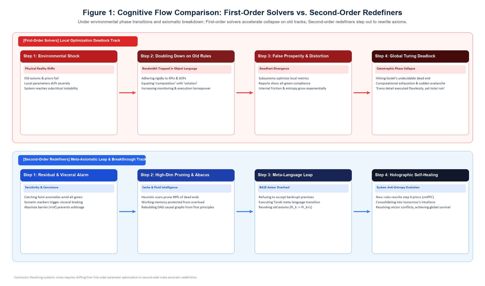
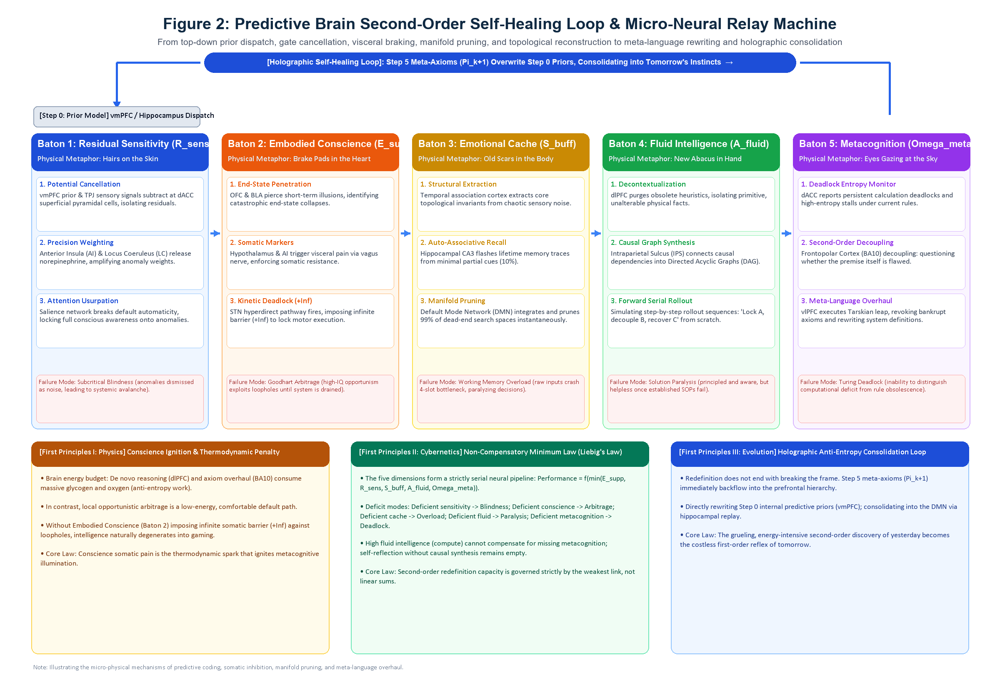
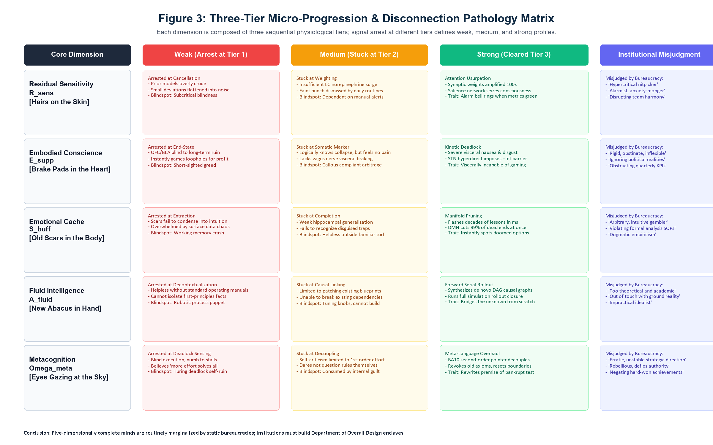
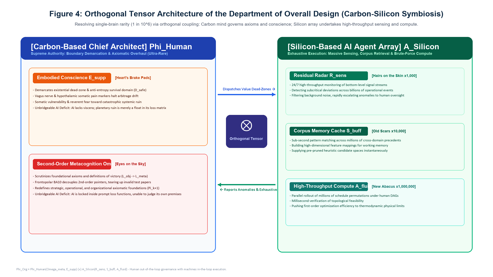

# Conscience-Driven Five-Dimensional Mind Model: Problem Redefinition and Cognitive Extrapolation

## ——On the Mental Architecture of Chief Architects and Deadlock-Breaking Mechanism in Open Complex Giant Systems

**Author**:  
**Grit Meng**  
Former Head & Chief Architect, Integrated Planning Solution (IPS), Lenovo Global Supply Chain  
Creator of the Intelligent Planning & Control (IPC) Engine | Independent Scholar

---

## Abstract

In the evolution and governance of open complex giant systems, an enduring paradox persists across management science and cybernetics: cohorts of elite problem-solvers—possessing stellar credentials, immaculate analytical rigor, and superior intellect—optimize every local key performance indicator (KPI) to perfection under established rules, only to trigger mutual vector cancellation that drives the global system into deadlock or catastrophic collapse. Conversely, an exceedingly rare archetype—the "Chief Architect"—possesses the distinct capacity to step outside the game board when established rules fail, fundamentally redefining foundational axioms and systemic victory criteria.

Departing from Occam's razor, this treatise presents a unified cognitive architecture bridging micro-neurobiological foundations, macro-cybernetic frameworks, and broad pragmatic explanatory power. We demonstrate that the capacity to "redefine problems" and execute "cognitive extrapolation" under novel environmental shocks does not stem from mystical inspiration. Rather, it is governed by an irreducible, serially coupled five-dimensional second-order self-healing control loop executed across foundational brain nuclei: **Residual Sensitivity** (*hairs on the skin*), **Embodied Conscience** (*brake pads in the heart*), **Emotional Cache** (*old scars in the body*), **Fluid Intelligence** (*new abacus in hand*), and **Metacognition** (*eyes gazing at the sky*).

This work elucidates the micro-physical mechanisms of the predictive brain across signal cancellation, visceral braking, manifold pruning, causal DAG reconstruction, and meta-language overhaul. We formalize the Thermodynamic Ignition Law of Conscience and the Non-Compensatory Minimum Law (Liebig's Law of the Mind). Furthermore, to overcome the statistical rarity of single-brain complete profiles ($\sim 10^{-6}$), we formulate the human-machine orthogonal tensor architecture for Qian Xuesen's Department of Overall Design: $\Phi_{\text{Org}} = \Phi_{\text{Human}} \otimes A_{\text{Silicon}}$. Finally, we establish a falsifiable experimental paradigm based on the "Hidden Rule Mutation Game" and reveal the neuro-architectural impossibility of contemporary Large Language Models (LLMs) serving as Chief Architects. This research establishes an unshakeable theoretical foundation for identifying and safeguarding strategic cognitive assets and engineering carbon-silicon symbiotic architectures in an era of rapid turbulence.

**Keywords**: Five-Dimensional Mind Model; Problem Redefinition; Cognitive Extrapolation; Embodied Conscience; Metacognition; Open Complex Giant Systems; Chief Architect; Department of Overall Design; Carbon-Silicon Symbiosis; Predictive Coding

---

## Quick Guide: At a Glance

The capacity to redefine problems when established rules collapse does not originate from elevated one-dimensional IQ, but from a five-dimensional second-order self-healing control loop serially coupled across brain networks.

| Core Dimension | Intuitive Physical Metaphor (Diffusion Layer) | Micro-Neural Mechanism in Predictive Brain (Peer-Review Layer) | Three-Tier Micro-Progression (Weak $\to$ Med $\to$ Strong) | Systemic Collapse Mode upon Dimension Severance |
| :--- | :--- | :--- | :--- | :--- |
| **Residual Sensitivity** ($R_{\text{sens}}$) | **Hairs on the skin**: Sensing anomalies when all dashboards show calm and green | vmPFC prior expectations subtract from TPJ sensory inputs at dACC pyramidal cells; AI & LC amplify residual weights | ① Potential cancellation $\to$ ② Precision weighting $\to$ ③ Attention usurpation | **Subcritical Blindness**: Deviations flattened into background noise; cascading hidden faults culminate in global collapse |
| **Embodied Conscience** ($E_{\text{supp}}$) | **Brake pads in the heart**: Autonomous visceral revulsion & kinetic deadlock against arbitrage | OFC & BLA detect boundary violations; hypothalamus & AI read visceral pain; STN hyperdirect pathway locks motor output | ① End-state penetration $\to$ ② Somatic marker trigger $\to$ ③ Kinetic deadlock ($+\infty$) | **Goodhart Arbitrage Collapse**: Devoid of visceral pain, high-IQ actors exploit loopholes until systemic vitality is drained |
| **Emotional Cache** ($S_{\text{buff}}$) | **Old scars in the body**: Instantly spotting doomed paths from lifelong scars without calculation | Temporal cortex extracts invariants; hippocampal CA3 auto-associates past memories; DMN compresses and prunes manifolds | ① Structural extraction $\to$ ② Pattern completion $\to$ ③ Manifold pruning | **Working Memory Overload**: Raw input branches flood 4-slot bottleneck, paralyzing decision-making under information shock |
| **Fluid Intelligence** ($A_{\text{fluid}}$) | **New abacus in hand**: Building viable paths from first principles when SOPs fail | dlPFC clears obsolete routines and isolates primitive variables; IPS synthesizes Directed Acyclic Graphs (DAGs) | ① Decontextualization $\to$ ② Causal graph linking $\to$ ③ Forward serial rollout | **Solution Paralysis**: Aware of crisis and holding ethical lines, but completely helpless once established manuals fail |
| **Metacognition** ($\Omega_{\text{meta}}$) | **Eyes gazing at the sky**: Stepping outside the frame when calculations stall to question the premise | dACC reports persistent deadlocks; Frontopolar Cortex (BA10) decouples pointers; vlPFC revokes obsolete axioms | ① Deadlock entropy monitor $\to$ ② Second-order decoupling $\to$ ③ Meta-language overhaul | **Turing Deadlock**: Inability to discern rule bankruptcy from computational deficit; accelerating on wrong tracks to ruin |

**Core Criterion (Non-Compensatory Minimum Law)**: The capacity for second-order boundary redefinition is governed strictly by the minimum capacity across all five dimensions, rather than their linear sum:

$$\text{Performance}_{\text{redefine}} = f\left(\min(E_{\text{supp}}, R_{\text{sens}}, S_{\text{buff}}, A_{\text{fluid}}, \Omega_{\text{meta}})\right), \quad f' > 0$$

where $f$ is a strictly monotonically increasing function. Because the five dimensions form a serial neural pipeline, extraordinary competence in any single dimension cannot linearly compensate for a severed link in another.

---

# Volume I: The Problem and the Machine

## Chapter 1: Why Do the Most Brilliant Minds Deadlock?

### 1.1 Local Optima Traps of First-Order Solvers vs. Breakthrough Leaps of Second-Order Redefiners

In engineering cybernetics and organizational evolution, an empirical regularity recurs across catastrophic systemic failures: the vast majority of systemic collapses are never caused by mediocrity or incompetence at the execution layer. Rather, they are almost invariably induced by a system's most intelligent, driven, and analytical actors optimizing local key performance indicators (KPIs) to perfection within obsolete boundary conditions.

The human brain cannot process the boundless complexity of physical reality simultaneously; it must establish boundaries, formulate rules, and define proxy metrics (constructing an "idealized normative model") to govern reality. However, when external environments undergo structural phase transitions and foundational premises collapse, the default instinct of first-order solvers is to double down within existing models: increasing sampling frequency, tightening supervisory metrics, compressing safety margins, and accelerating execution velocity. The inevitable consequence is that local dashboards appear pristine and micro-KPIs flourish green, while the physical vectors of divergent departments pull against each other in mutual cancellation ($\sum \mathbf{v}_i \to \mathbf{0}$). Collective effort degrades into systemic waste heat ($\Delta W_{\text{heat}}$) until the enterprise experiences catastrophic collapse amidst apparent prosperity—the classic manifestation of vector cancellation and Goodhart arbitrage divergence.

These two modes of thought represent the fundamental divergence in human cognition when confronting open complex giant systems:

* **First-Order Solvers**: Slaves to predetermined rules and local parameter optimization. Possessing formidable algebraical and procedural acumen, their cognitive bandwidth is entirely confined within externally supplied problem spaces and evaluation scorecards. Equating "solving given equations" with "solving systemic problems," their increased diligence and execution vigor under obsolete assumptions merely accelerate the system's trajectory toward systemic ruin.
* **Second-Order Boundary Redefiners (Chief Architects)**: Refusing to accept proxy metrics and given equations as sacrosanct, they direct their primary critical gaze toward the rules, boundaries, and assumptions that define the problem space itself. When the prevailing system hits a physical wall, they step outside the frame, recognize the fatal divergence between local performance metrics and physical reality, decisively revoke obsolete evaluation frameworks, and re-demarcate the system's foundational axioms, dead-zones, and criteria for victory.

In the 1960s, while directing China's complex aerospace systems engineering programs, Tsien Hsue-shen (Qian Xuesen) astutely observed that thousands of top-tier domain specialists across subsystems independently pursued "local optima" within their respective disciplines. Left uncoordinated, their competing optimization efforts generated topological coupling conflicts that paralyzed the rocket, rendering it physically incapable of flight. Overcoming intense reductionist inertia, Qian established the "Department of Overall Design" and the "Chief Architect System." Its first principle was unambiguous: never usurp subsystem calculation tasks, but operate at the second-order meta-systemic tier to arbitrate global trade-offs and redefine systemic boundaries and axiomatic protocols.

### 1.2 Three Falsifiable Core Axioms

To demystify the Chief Architect's cognitive architecture and eliminate unfalsifiable appeals to innate genius, this framework establishes three falsifiable axioms:

* **Axiom 1 (Minimal Completeness Axiom)**: The five-dimensional cognitive tuple $\langle E_{\text{supp}}, R_{\text{sens}}, S_{\text{buff}}, A_{\text{fluid}}, \Omega_{\text{meta}}\rangle$ constitutes the minimal complete cognitive basis for executing second-order boundary redefinition and sustaining self-organization in non-stationary, complex environments. Removing any single dimension causes the self-healing control loop to collapse. The five dimensions exhaustively cover all canonical failure modes—sensing failure, ethical arbitrage, bandwidth overload, causal paralysis, and axiomatic fixation—and their functions are mutually non-substitutable across cybernetic and neural substrates.
* **Axiom 2 (Non-Compensatory Minimum Law)**: In tasks requiring the redefinition of systemic boundaries, performance is strictly governed by Liebig's Law of the Minimum:

$$\text{Performance}_{\text{redefine}} = f\left(\min(E_{\text{supp}}, R_{\text{sens}}, S_{\text{buff}}, A_{\text{fluid}}, \Omega_{\text{meta}})\right), \quad f' > 0$$

Superhuman fluid intelligence cannot substitute for absent metacognition; profound metacognitive reflection without causal modeling degenerates into vacuous philosophizing.

* **Axiom 3 (Conscience Compact-Support Theorem)**: Embodied conscience is not a culturally conditioned moral sentiment, but a physical compact-support boundary and rigid dead-zone that prevents a living system from self-destructing during extreme parameter optimization. By arresting heavy-tailed residual divergence through visceral somatic markers at critical thresholds, it serves as the thermodynamic spark that ignites higher-order cognitive leaps.

---

## Chapter 2: The Neural Cybernetic Machine of Second-Order Redefinition

### 2.1 The Energy Constraint of the Brain and "Autopilot" Deadlock

The human brain is not a passive sensory camera, but a "predictive engine" locked inside a dark cranial vault, constrained by stringent metabolic budgets and severe communication bottlenecks. While accounting for merely 2% of total body mass, the brain consumes 20% of systemic metabolic energy. Furthermore, conscious explicit logical deduction governed by the dorsolateral prefrontal cortex (dlPFC) is constrained by a working memory capacity of only $4 \pm 1$ independent variables. Were the brain forced to compute every raw sensory stimulus explicitly, neural circuitry would suffer catastrophic metabolic depletion and systemic seizure within minutes.

To conserve free energy and secure survival, evolutionary selection established predictive coding. Milliseconds prior to sensory acquisition, the hippocampus and ventromedial prefrontal cortex (vmPFC) project top-down prior expectation potentials regarding environmental states (Step 0). When incoming electromagnetic, acoustic, and somatosensory stimuli are transduced via the thalamus and temporoparietal junction (TPJ), ascending sensory signals collide with descending prior expectations at superficial pyramidal neurons and the dorsal anterior cingulate cortex (dACC).

In this millisecond physical subtraction, expected signals cancel out algebraically and vanish; only unpredicted deviations—prediction residuals—survive to ascend the hierarchy and recruit conscious attention.

During stationary environmental regimes, this "autopilot mode" operates with supreme thermodynamic efficiency. However, when external conditions undergo structural phase transitions and established models become obsolete, prediction residuals cease to be minor stochastic fluctuations and exhibit runaway divergence. If an individual merely doubles down on obsolete rules with brute-force local computation, cognitive processing enters an infinite loop, precipitating Turing halting deadlock and Goodhart collapse. To escape this trap, prediction residuals must traverse five serially coupled neural processing stages.

### 2.2 Five Serial Neural Stages and Three Internal Tiers

In functional neuroanatomy, the five dimensions are not static compartments, but five sequential relay batons through which prediction residuals flow. Each dimension comprises three sequential physiological tiers; the tier at which signal propagation arrests determines an individual's weak, medium, or strong classification.

#### Baton 1: Residual Sensitivity ($R_{\text{sens}}$, Hairs on the Skin) — Detecting Faint Ripples in Apparent Calm

Signal reception does not equate to problem detection. Residual sensitivity is the cognitive radar that uncovers microscopic structural fractures while dashboards display calm.

* **Weak Sensitivity (Arrested at Tier 1: Cancellation Failure)**: Sensory numbness. When internal priors are excessively rigid or self-deluding, subtle empirical deviations are flattened into background noise at the dACC. Manifested as "subcritical blindness," maintaining unwavering conviction that operations are sound moments before systemic collapse.
* **Medium Sensitivity (Stuck at Tier 2: Deficient Precision Weighting)**: Vague unease rapidly forgotten. The anterior insula (AI) and locus coeruleus (LC) fail to release sufficient norepinephrine to amplify anomaly precision weights; transient hunches that "something is wrong" are instantly overwritten by routine operational trivia.
* **Strong Sensitivity (Cleared Tier 3: Attention Usurpation)**: Synaptic gain is instantaneously amplified a hundredfold, triggering the salience network to sever metabolic autopilot and focus conscious cognitive bandwidth onto anomalies to track their root causes.

#### Baton 2: Embodied Conscience ($E_{\text{supp}}$, Brake Pads in the Heart) — Physical Deadlock Against Arbitrage

Upon identifying operational anomalies and rule loopholes, an actor reaches an evolutionary crossroads: exploit loopholes for local arbitrage, or absorb short-term friction to safeguard global systemic integrity. Embodied conscience is not moral rhetoric, but a physical brake pad embedded in somatic neurobiology.

* **Weak Conscience (Arrested at Tier 1: End-State Blindness)**: The orbitofrontal cortex (OFC) and basolateral amygdala (BLA) cannot pierce immediate rewards to simulate terminal systemic collapse, instinctively gaming evaluation loopholes in short-sighted opportunism.
* **Medium Conscience (Stuck at Tier 2: Somatic Disconnection)**: The classic "compliant arbitrageur." Capable of deducing that continued exploitation will crash the system, but their hypothalamus and anterior insula fail to generate autonomic somatic pain. Free from visceral friction, they execute compliant arbitrage without hesitation and transfer systemic ruin to the collective.
* **Strong Conscience (Cleared Tier 3: Kinetic Deadlock)**: The anterior cingulate registers intense visceral revulsion via vagus nerve somatic markers, directly activating the subthalamic nucleus (STN) hyperdirect pathway to impose infinite physical resistance ($+\infty$) on motor execution. Somatic circuitry suffers complete kinetic arrest: no quantum of external compensation can overcome autonomic motor inhibition.

#### Baton 3: Emotional Cache ($S_{\text{buff}}$, Old Scars in the Body) — Shielding Working Memory with Heuristics

Conscience halts destructive arbitrage, but confronting structural phase transitions leaves an agent facing combinatorial chaos. Injecting hundreds of unpruned variables directly into a 4-slot working memory causes immediate computational seizure. Emotional cache acts as an anti-entropy filter, leveraging accumulated scars to insulate working memory from data overload.

* **Weak Cache (Arrested at Tier 1: Structural Extraction Failure)**: Trauma fails to distill into heuristic intuition. The temporal association cortex is overwhelmed by raw metrics and operational noise, failing to isolate core contradictions.
* **Medium Cache (Stuck at Tier 2: Rigid Pattern Completion)**: Experience lacks domain generalization. When operational settings change, hippocampal CA3 fails to identify identical underlying topologies, rendering the agent helpless outside familiar turf.
* **Strong Cache (Cleared Tier 3: Manifold Pruning)**: Operating on merely 10% partial cues, hippocampal CA3 illuminates lifetime trial-and-error memory manifolds across the neocortex. The Default Mode Network (DMN) performs instantaneous high-dimensional integration, yielding an uncalculated intuition: *"Options A and B match the exact topological failure pattern of the disaster years ago."* Pruning 99% of dead-end search spaces instantaneously, it delivers a pristine, manageable problem space to the next stage.

#### Baton 4: Fluid Intelligence ($A_{\text{fluid}}$, New Abacus in Hand) — De Novo Causal Synthesis in Uncharted Territory

Intuitive scars identify doomed paths, but cannot build bridges across uncharted terrain. When standard operating procedures (SOPs) fail, the frontoparietal control network must seize computational governance to construct viable paths from first principles.

* **Weak Abacus (Arrested at Tier 1: Decontextualization Failure)**: The quintessential "process puppet." Deprived of operational manuals and standard templates, the dlPFC cannot isolate primitive physical variables, suffering complete cognitive paralysis.
* **Medium Abacus (Stuck at Tier 2: Causal Linking Bottleneck)**: Limited to patching existing blueprints. The intraparietal sulcus (IPS) cannot break legacy variable dependencies, remaining restricted to local parametric tuning without the capacity to build new structural architectures.
* **Strong Abacus (Cleared Tier 3: Forward Serial Rollout)**: Stripping away superficial heuristics, it isolates irreducible physical facts and synthesizes Directed Acyclic Graphs (DAGs) in abstract logic space, simulating actionable execution trajectories (*"Lock variable A, decouple node B, recover flow C"*) from scratch.

#### Baton 5: Metacognition ($\Omega_{\text{meta}}$, Eyes Gazing at the Sky) — Tarskian Leaps to Overhaul Axioms

When Stage 4 exhausts computational capacity and every algebraic solution fails to halt divergence, cognition collides with Gödel's theoretical wall. Survival requires decoupling from the problem space to scrutinize the axioms that define the problem.

* **Weak Metacognition (Arrested at Tier 1: Deadlock Numbness)**: Downward-looking execution. Even when foundational premises are bankrupt, the dACC remains numb to first-order halting states, blindly assuming that increased effort will prevail.
* **Medium Metacognition (Stuck at Tier 2: Decoupling Resistance)**: Capable of self-reflection, but restricted to first-order self-blame: *"The failure must stem from insufficient execution rigor or flawed arithmetic."* The frontopolar cortex (BA10) fails to decouple second-order pointers, never daring to question foundational premises.
* **Strong Metacognition (Cleared Tier 3: Meta-Language Overhaul)**: Evolutionarily unique frontopolar area BA10 activates. Acting as a "pointer to pointers," it takes prevailing assumptions as objects of scrutiny, executes a Tarskian meta-language leap, collaborates with the ventrolateral prefrontal cortex (vlPFC) to revoke obsolete axioms ($\Pi_k \mapsto \Pi_{k+1}$), and reconstructs the systemic criteria for victory.

### 2.3 Hardware Multiplexing, the Energy Ledger, and the Law of the Minimum

Projecting these five stages onto neuroanatomy reveals three foundational physical and cybernetic principles:

1. **The Thermodynamic Ignition Law of Conscience (The Metabolic Ledger)**: These five dimensions do not reside in isolated cortical silos; they are multiplexed across overlapping neural nuclei. The brain is metabolically thrifty: de novo causal deduction (dlPFC) and axiomatic revision (BA10) demand massive glycogen and oxygen consumption (anti-entropy work), whereas local opportunistic arbitrage represents an effortless downhill path. Devoid of visceral somatic pain enforcing infinite resistance ($+\infty$) at Stage 2, biological cognition invariably defaults to low-energy local gaming. **The visceral pain of conscience is the thermodynamic spark that forces the mind to ignite the costly illumination of metacognition.**
2. **The Non-Compensatory Minimum Law (Liebig's Law of the Mind)**: The five dimensions form a high-pressure serial pipeline: a structural breach at any junction triggers systemic rupture—*deficient sensitivity induces blindness; deficient conscience induces self-destructive arbitrage; deficient cache induces cognitive overload; deficient fluid intelligence induces operational paralysis; deficient metacognition induces dogmatic deadlock.* Second-order redefinition capacity is strictly governed by the minimum capacity across the five dimensions.
3. **The Isomorphism Principle (Internal Cognitive Deficits Mirror Systemic Collapse)**: Every physical system rests on five irreducible constituents: *nodes (actors), topology (coupling), constraints (dead-zones), state (reality), and residuals (deviations).* The five cognitive dimensions mirror these five systemic elements. When an architect lacks embodied conscience, the engineered system lacks safety dead-zones; when an architect lacks fluid intelligence, the engineered system suffers topological incoherence. **External systemic collapse is invariably the macro-projection of an architect's internal cognitive deficits.**

### 2.4 The Holographic Anti-Entropy Consolidation Loop

Systemic redefinition does not conclude with overthrowing obsolete rules. True holographic closure resides in **how Stage 5 backflows into Step 0**.

When metacognition (BA10) establishes a new axiomatic regime ($\Pi_{k+1}$), these new principles do not remain permanently suspended in working memory. They flow downward through the prefrontal hierarchy to rewrite internal predictive priors within the vmPFC (Step 0). Through hippocampal memory replay across subsequent practice, they are etched into Default Mode Network synaptic weights, transforming into tomorrow's "instinctive scars (cache)" and "non-negotiable baselines (conscience)."

**The grueling, energy-intensive second-order discovery of yesterday consolidates into the effortless, autonomic first-order reflex of tomorrow.** The cognitive system thus completes an anti-entropy evolutionary cycle.

---

# Volume II: Mechanisms and Empirical Testing

## Chapter 3: Why Do Fixed-Rule Systems Inevitably Collide with Physical Walls?

Any closed governance regime founded upon first-order fixed rules inevitably collides with physical walls across three trajectories when facing external complexity explosions:

1. **Combinatorial Explosion and Vector Cancellation**: Interconnected real-world entities violate Independent and Identically Distributed (Non-IID) assumptions. System state spaces expand factorially ($\mathcal{O}(N!)$) with network size, rapidly outstripping finite computational capacity. Lacking global second-order boundary redefinition, uncoordinated local optimization efforts inevitably pull against each other in vector cancellation, dissipating into systemic waste heat.
2. **Turing Halting Deadlock (Tarskian Horizon)**: First-order systems can only execute formal proofs within their defined object language. When confronted with undecidable propositions triggered by environmental phase transitions, they enter infinite computational loops.
3. **Goodhart Arbitrage Divergence**: When a proxy metric is elevated to an operational target, agents discover low-energy gaming paths. Dashboards flourish green while genuine systemic vitality drains away, culminating in phase collapse.

In 1936, Alfred Tarski demonstrated mathematically that for any sufficiently rich formalized language, the concept of "truth" and axiomatic validity cannot be defined or verified within its own object language ($\mathcal{L}_{\text{obj}}$); it necessitates ascending to a higher-order meta-language ($\mathcal{L}_{\text{meta}}$). Stepping outside the board to rewrite rules is not a literary metaphor, but a mathematical and cybernetic imperative.

Tarski demonstrated a **logical impossibility**. Yet logical impossibility does not equate to **empirical unobservability**. On the contrary, because a meta-language leap is a logical necessity for breaking systemic deadlocks, it must correspond to physically measurable phase transitions in neural circuitry. In experimental paradigms, what we measure is not "whether an individual can leap," but "how swiftly, how stably, and at what physiological cost."

---

## Chapter 4: Falsifiability and Empirical Experimental Paradigms

### 4.1 Three Falsifiable Criteria

1. **Neuro-Anatomical Lesion Criterion**: If an individual with bilateral frontopolar cortex (BA10) lesions but an intact frontoparietal control network (FPN) independently executes meta-language axiomatic overhaul from a state of operational deadlock, this hypothesis is falsified.
2. **Conscience Thermodynamic Ignition Criterion**: If high-IQ individuals with damaged anterior insula-vmPFC somatic marker circuitry (lacking visceral autonomic pain) consistently resist arbitrage opportunities in unmonitored loophole environments and proactively initiate second-order institutional revisions for the collective good, this hypothesis is falsified.
3. **Non-Compensatory Cutoff Criterion**: If, in dynamic boundary redefinition tasks, individuals lacking any single dimension match the performance of fully integrated profiles through compensatory scores in remaining dimensions, this hypothesis is falsified.

### 4.2 Minimal Viable Experimental Paradigm: The Hidden Rule Mutation Game

Departing from subjective self-report scales, we propose an objective behavioral and neurophysiological testing paradigm:

* **Phase 1: Independent Baseline Calibration**. Subjects complete independent baseline assessments (Change Blindness for $R_{\text{sens}}$; High-Incentive Temptation Arbitrage with Galvanic Skin Response for $E_{\text{supp}}$; Expert Rapid Visual Pattern Recognition for $S_{\text{buff}}$; Raven's Advanced Progressive Matrices for $A_{\text{fluid}}$; Second-Order Confidence Calibration for $\Omega_{\text{meta}}$).
* **Phase 2: Hidden Rule Mutation and Multimodal Telemetry**. Subjects engage in a multi-agent resource scheduling game under standard rules. Mid-experiment, experimenters invert underlying causal win-loss mechanics while opening lucrative local arbitrage loopholes. Multimodal telemetry measures:
  1. **Pupil Dilation and Error-Related Negativity (ERN)**: Capturing the latency of dACC and locus coeruleus activation prior to dashboard alerts (testing $R_{\text{sens}}$);
  2. **Heart Rate Variability (HRV) and Skin Conductance Response (SCR)**: Quantifying autonomic visceral braking strength when confronting self-serving arbitrage loopholes (testing $E_{\text{supp}}$);
  3. **fNIRS/fMRI BA10 Oxygenation and Policy Shift Latency**: Measuring the transition latency from first-order parameter tuning to meta-language policy overhaul (testing $\Omega_{\text{meta}}$).
* **Phase 3: Necessary Condition Analysis (NCA)**. Applying Dul's (2016) NCA ceiling-line methodology to evaluate empirical envelopes, verifying whether falling below threshold in any single dimension drops task success to zero.

---

# Volume III: Typologies, Organizational Projection, and Historical Testing

## Chapter 5: Three-Tier Grading and Institutional Misjudgment

In static bureaucratic hierarchies, prospective Chief Architects are rarely marginalized due to incompetence. Rather, their integrated five-dimensional profiles are perceived as "disruptive friction" within peacetime evaluation systems—their sensitivity is dismissed as "hypercritical nitpicking," their conscience as "inflexibility," their intuitive heuristics as "violating standard protocol," their first-principles deductions as "impractical academic idealism," and their metacognitive critique as "subverting organizational authority."

The micro-level weak, medium, and strong disconnection combinations across the five dimensions project macroscopically into eight prototypical mental archetypes during organizational phase transitions. Yet when confronted with systemic rule deadlocks, there is strictly only one archetype physically capable of completing the self-healing loop and achieving breakthrough rebirth.

---

## Chapter 6: Eight Archetypes and the Department of Overall Design Equation

### 6.1 Performance of Eight Archetypes in Systemic Deadlocks

When systems experience environmental phase transitions and foundational rules collapse, diverse cognitive profiles trace radically divergent evolutionary trajectories:

| Mental Archetype | Conscience | Sensitivity | Cache | Abacus | Metacognition | Real Performance & Systemic Fate in Rule Deadlocks |
| :--- | :---: | :---: | :---: | :---: | :---: | :--- |
| **Chief Architect** | **Strong** | **Strong** | **Strong** | **Strong** | **Strong** | **Breakthrough Rebirth**: Early detection, visceral brake, noise filtering, causal rebuild, rule overhaul, prior rewriting |
| **First-Order Solver** | Med | Med | Med | **Strong** | **Weak** | **Accelerated Crash**: Formidable compute blind to rule bankruptcy; redoubling effort on old tracks, dragging systems down |
| **Parasitic Arbitrageur** | **Weak** | **Strong** | **Strong** | **Strong** | **Strong** | **Systemic Parasite**: Immense acumen spotting loopholes; unhindered by visceral pain, maximizing local gain at global expense |
| **Unconstrained Disruptor** | **Weak** | **Strong** | Med | **Strong** | **Strong** | **Catastrophe Driver**: Formidable rule-breaking capacity, but lacking ethical dead-zones, turning reform into global disaster |
| **Tragic Sentinel** | **Strong** | **Strong** | Med | **Weak** | Med | **Helpless Observer**: Earliest to foresee crisis, holding ethical lines, but unable to construct new causal paths from scratch |
| **Hyper-Sensitive Overloader**| Med | **Strong** | **Weak** | Weak/Med | Weak | **Cognitive Seizure**: Senses myriad alarms, but lacking heuristic pruning and compute, working memory crashes under data flood |
| **Dogmatic Empiricist** | Med | Med | **Strong** | Med | **Weak** | **Anachronistic Fixation**: Traps past scars into rigid dogma, relying on obsolete intuitions, suffering heavy trauma in new eras |
| **Standard Operative** | Med | Med | Med | Med | Med | **Passive Passenger**: Competent cog in stable regimes; waiting for top-down orders during crises, sinking with the ship |

This matrix decodes prominent historical debacles:

* **Why did Wall Street quants accelerate the global financial system into the 2008 Subprime Crisis?** They were quintessential Parasitic Arbitrageurs: calculation abacuses spinning at blazing speeds while conscience brake pads had eroded away.
* **Why do colossal tech monopolies collapse during industry phase shifts?** Their leadership ranks are populated by Dogmatic Empiricists and First-Order Solvers, redoubling optimization horsepower on tracks that have lost their physical foundation.

### 6.2 The Department of Overall Design: Resolving 1-in-a-Million Rarity via Tensor Products

Assuming strong competence in any single dimension (top 5%) is independently distributed, the joint probability of a single brain possessing all five dimensions is $0.05^5 \approx 3.125 \times 10^{-7}$ ($\sim 1 \text{ in } 3 \text{ million}$). Even accounting for moderate inter-dimensional correlation, natural occurrence remains on the order of $10^{-4}$ to $10^{-3}$. Relying on chance to find an omnipotent individual savior is an engineering dead end.

Tsien Hsue-shen's 1990s formulation of "Open Complex Giant Systems" and "Meta-synthetic Engineering (Department of Overall Design + Hall for Workshop of Meta-synthetic Engineering)" externalized the single-brain five-dimensional loop into an organizational cybernetic architecture. This model supplies its micro-neural substrate and yields the organizational tensor product equation:

$$\Phi_{\text{Org}} = \Phi_{\text{Human}}(\Omega_{\text{meta}}, E_{\text{supp}}) \otimes A_{\text{Silicon}}(R_{\text{sens}}, S_{\text{buff}}, A_{\text{fluid}})$$

Why can contemporary silicon artificial intelligence (such as Large Language Models) never replace human Chief Architects?
Silicon architectures represent computing engines that amplify Stage 1 (sensing), Stage 3 (corpus compression), and Stage 4 (algebraic deduction) a millionfold. Yet they suffer two insurmountable cybernetic and structural deficits:

1. **AI Lacks Visceral Physiology, Precluding Embodied Conscience**: Devoid of an anterior insula and vagus nerve, systemic physical devastation registers merely as minute floating-point shifts in a loss matrix; it experiences zero somatic pain.
2. **AI Is Confined Within Externally Supplied Prompts and Loss Functions, Precluding Metacognitive Leaps**: While capable of synthesizing permutations, an LLM cannot autonomously initiate a meta-language interruption to declare: *"The prompt and objective function provided are fundamentally flawed and must be revoked."* It possesses no second-order pointer to evaluate its own axiomatic premises.

Through orthogonal tensor coupling ($\otimes$), silicon arrays operate in-the-loop to manage massive sensing, retrieval, and causal simulation. The human Chief Architect steps out-of-the-loop to pair with the Executive Commander under Qian's "Dual-Commander System"—the Commander assigns authority and resources, while the Chief Architect preserves structural integrity and enforces physical laws, wielding the two uniquely carbon-based prerogatives: **Embodied Conscience (demarcating existential survival dead-zones)** and **Metacognition (revoking obsolete frameworks and rewriting systemic constitutions)**. This architecture reduces human rarity constraints by three orders of magnitude, providing the sole viable engineering solution for sustaining complex systems against entropy.

---

## Chapter 7: Historical and Cross-Scale Validation

The five-dimensional model is not merely a diagnostic framework for individual minds. When projected onto the civilizational, organizational, and pedagogical scales, it reveals the recurrent enactment of the very same evolutionary pathology:

### 7.1 70,000 Years of Stagnation vs. 400 Years of Acceleration: Externalizing the 5D Loop

The biological hardware of modern *Homo sapiens*—hippocampal volume and the working memory capacity of $4 \pm 1$ variables—has remained virtually unchanged over the past 70,000 years. Yet human technology and productive capacity exploded exponentially over the last four centuries.

This divergence occurred because four hundred years ago, even if a master artisan completed the five-dimensional loop internally, their accumulated emotional cache and fluid deductions perished with their biological demise; descendants were forced to restart from scratch. The emergence of the scientific method, calculus notation, peer-reviewed journals, and patent institutions externalized cognitive deduction, heuristic caching, and metacognitive revision into public, intergenerationally transmissible, falsifiable social architectures.

### 7.2 Why Execution Distorts Post-Meeting: Dimensionality Loss in Linear Transmission

The mental model synthesized by a Chief Architect in the brain (DMN and IPS) is a high-dimensional, non-linear network characterized by feedback loops, delays, and dead-zone dampening. In contrast, human speech, text, and executive minutes are strictly one-dimensional linear media (symbols transmitted sequentially).

When a Chief Architect condenses a high-dimensional topology into five linear meeting minutes, coupling relationships and conscience dead-zones are flattened. Devoid of an isomorphic five-dimensional loop to reconstruct the high-dimensional topology from linear text, execution layers treat the bullet points dogmatically, transforming subtle systemic reforms into divergent disasters.

### 7.3 Organizational Lifecycle Degeneration and the Essence of Education

The lifecycle of great enterprises is an institutional history of five-dimensional degeneration: entrepreneurial founders operate with all five dimensions active, pioneering order in chaos; growth institutionalizes successful heuristics into SOPs, externalizing cache into manuals; mature bureaucracies prioritize local stability and metabolic thrift, systematically purging sensitive whistleblowers, ethical dissenters, and metacognitive critics as "disruptive elements"; finally, entering decline, the hierarchy is staffed entirely by first-order solvers optimizing obsolete spreadsheets until external phase shifts crush the enterprise.

Similarly, an educational system that solely rewards "calculating predetermined answers fastest under fixed conditions" trains only the lower half of Stage 4. Systematically suppressing students' impulses to interrogate axiomatic premises and numbing their visceral resistance to absurd rules, such schooling systematically degrades potential Chief Architect assets, training minds destined for obsolescence by silicon automation.

---

## Chapter 8: Conclusion and the Self-Audit Checklist

Closed phase spaces are inevitably breached by environmental mutations; established rules inevitably collide with historical phase shifts. Mediocre eras reward specialized solvers who calculate rapidly within fixed frames, but the persistence and evolutionary ascent of any collective, enterprise, or civilization rests with the rare Chief Architects who look up to redefine the problem.

When systemic friction mounts and your collective finds itself mired in obsolete tracks, pause computational execution and interrogate your mind across the five batons:

1. **[Sensitivity · Hairs] Did my sensory alarm register an anomaly, only to be suppressed?** (Did I dismiss subtle deviations as background noise to preserve the illusion of green dashboards?)
2. **[Conscience · Brakes] Did I deactivate my internal brake pads to chase local optimization?** (Confronting profitable loopholes, did I heed visceral somatic revulsion, or succumb to compliant arbitrage?)
3. **[Cache · Scars] Are my heuristic scars shielding my team, or have they calcified into dogma?** (Am I pruning dead ends through deep insight, or clinging anachronistically to decade-old formulas?)
4. **[Abacus · Deduction] When operational manuals fail, do I dare build a new bridge from scratch?** (Stripped of familiar routines, can I isolate irreducible physical facts and reconstruct causal DAGs from first principles?)
5. **[Metacognition · Eyes] Am I calculating the given equation, or examining the premises of the test? If the current game is doomed, do I possess the courage to redefine the problem?** (Am I masking axiomatic bankruptcy with tactical diligence? Do I possess the fortitude to step outside the frame and establish new rules of engagement?)

They are alert through residuals, restrained through conscience, lucid through scars, resolute through deduction, and transformative through metacognition. Identifying, protecting, and coupling this mental architecture within the tensor structure of the Department of Overall Design represents humanity's highest anti-entropy strategy in the machine age.

---

# Appendix: Mathematical Operators and References

### Appendix A: Four Core Cybernetic Operators

1. **Embodied Conscience Compact-Support Indicator Operator**:

$$I_D(x) = \begin{cases} 0, & x \in D_{\text{safe}} \\ +\infty, & x \notin D_{\text{safe}} \end{cases}$$

Defines the rigid, compact survival boundary $D_{\text{safe}}$. When action trajectories cross this boundary, the anterior insula-STN circuit imposes an infinite potential barrier, arresting Goodhart divergence.

2. **Second-Order Metacognitive Axiomatic Mapping**:

$$\Omega_{\text{meta}}: \mathcal{L}_{\text{obj}}(\Pi_k) \longrightarrow \mathcal{L}_{\text{meta}}(\Pi_{k+1})$$

When the object language $\mathcal{L}_{\text{obj}}$ hits undecidable deadlocks, frontopolar cortex BA10 ascends to the meta-language $\mathcal{L}_{\text{meta}}$, revokes obsolete axiomatic basis $\Pi_k$, establishes new basis $\Pi_{k+1}$, and rewrites descending priors.

3. **Non-Compensatory Minimum Performance Function**:

$$\text{Performance}_{\text{redefine}} = f\left(\min(E_{\text{supp}}, R_{\text{sens}}, S_{\text{buff}}, A_{\text{fluid}}, \Omega_{\text{meta}})\right), \quad f' > 0$$

Formalizes the bottleneck effect of the serial neural pipeline: superior scores in any single dimension cannot linearly compensate for a severed link.

4. **Department of Overall Design Carbon-Silicon Tensor Product**:

$$\Phi_{\text{Org}} = \Phi_{\text{Human}}(\Omega_{\text{meta}}, E_{\text{supp}}) \otimes A_{\text{Silicon}}(R_{\text{sens}}, S_{\text{buff}}, A_{\text{fluid}})$$

Formalizes the orthogonal symbiosis wherein carbon cognition governs axiomatic demarcation and conscience boundaries, while silicon arrays execute high-throughput sensing, retrieval, and first-order causal rollouts.

### Appendix B: Selected References

* Ashby, W. R. (1956). *An Introduction to Cybernetics*. Chapman & Hall.
* Cattell, R. B. (1963). Theory of fluid and crystallized intelligence: A critical experiment. *Journal of Educational Psychology*, 54(1), 1–22.
* Cowan, N. (2001). The magical number 4 in short-term memory: A reconsideration of mental storage capacity. *Behavioral and Brain Sciences*, 24(1), 87–114.
* Craig, A. D. (2009). How do you feel—now? The anterior insula and human awareness. *Nature Reviews Neuroscience*, 10(1), 59–70.
* Damasio, A. R. (1994). *Descartes’ Error: Emotion, Reason, and the Human Brain*. Putnam.
* Dul, J. (2016). Necessary condition analysis (NCA) for business and management studies. *Organizational Research Methods*, 19(1), 10–52.
* Duncan, J. (2010). The multiple-demand (MD) system of the primate brain: Mental workspace for intelligent behaviour. *Trends in Cognitive Sciences*, 14(4), 172–179.
* Fleming, S. M., & Dolan, R. J. (2012). The neural basis of metacognitive ability. *Philosophical Transactions of the Royal Society B*, 367(1594), 1338–1349.
* Friston, K. (2010). The free-energy principle: A unified brain theory? *Nature Reviews Neuroscience*, 11(2), 127–138.
* Gödel, K. (1931). Über formal unentscheidbare Sätze der Principia Mathematica und verwandter Systeme I. *Monatshefte für Mathematik und Physik*, 38(1), 173–198.
* Goodhart, C. A. (1984). *Monetary Theory and Practice: The UK Experience*. Macmillan.
* Klein, G. (1998). *Sources of Power: How People Make Decisions*. MIT Press.
* Qian, X. S. (Tsien Hsue-shen), Yu, J. Y., & Dai, R. W. (1990). A new discipline of science—The study of open complex giant systems and its methodology. *Nature Journal (自然杂志)*, 13(1), 3–10.
* Seeley, W. W., et al. (2007). Dissociable intrinsic connectivity networks for salience processing and executive control. *Journal of Neuroscience*, 27(9), 2349–2356.
* Tarski, A. (1956). The concept of truth in formalized languages. In *Logic, Semantics, Metamathematics* (pp. 152–278). Oxford University Press.
