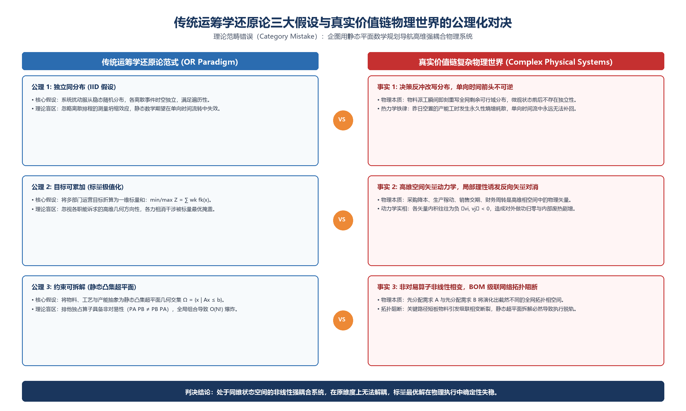

# 系统与复杂性科学 & 价值链物理学：秩序的生成、存续与进化
## Systems & Complexity Science & Value Chain Physics: The Generation, Persistence, and Evolution of Order
### —— 开放复杂巨系统的公理化形式证明、多项式可计算定理与超大规模工业闭环实证

**作者 / Author：**  

**孟凡淳 (Grit Meng)**  
前联想全球供应链集成计划方案（IPS）系统负责人兼总设计师  
IPC 智能计划与控制引擎缔造者 | 价值链物理学、系统与复杂性科学独立学者  

**Grit Meng**  
Former Head & Chief Architect, Integrated Planning Solution (IPS), Lenovo Global Supply Chain  
Creator of the Intelligent Planning & Control (IPC) Engine | Independent Scholar in Value Chain Physics and Systems & Complexity Science  

[](https://papers.ssrn.com/sol3/papers.cfm?abstract_id=7640758)
[%20%E2%88%88%20P-2ea043?style=flat-square)](Formal%20Proof%20of%20%27Living%20Expression%27%20and%20%27Self-Consistent%20Computability%27%20in%20Open%20Complex%20Giant%20Systems.pdf)
[-d29922?style=flat-square)](Value%20Chain%20Physics%20——%20Formal%20Proof%20of%20Open%20Complex%20Giant%20Systems%20and%20Full-Domain%20Computability%20Based%20on%20Non-IID%20Dynamics.pdf)
[](https://github.com/GritMeng/Value-Chain-Physics/tree/main/ipc-core-benchmark)
[](https://github.com/GritMeng/Value-Chain-Physics/tree/main/ipc-core-benchmark)

**官方门户 / Official Portal：** [https://gritmeng.github.io/Value-Chain-Physics/](https://gritmeng.github.io/Value-Chain-Physics/)  
**联系邮箱 / Email：** gritmeng@outlook.com  

---

## 🏛️ 从第一性原理到超大规模工业闭环的四层研究架构 (Four-Layer Research & Engineering Architecture)

本门户完整呈现开放复杂巨系统（Open Complex Giant Systems, OCGS）从**元科学公理形式化**、**微观死锁机理证明**、**千亿级跨国制造网络 18 年纵向实证**到 **C++17 裸金属开源算子基准**的端到端研究与工程闭环：

| 研究与工程层级 | 核心科学问题与系统边界 | 形式化原理与数学结论 | 实证基准与可复现验证入口 |
| :--- | :--- | :--- | :--- |
| **I. 元科学公理层**<br>*(Axiomatic Foundations)* | 强相干非独立同分布（Non-IID）开放复杂巨系统为何不可还原、如何生成并存续秩序？ | 确立划界相对律与五维双螺旋流形（$S = \mathcal{M}_{\text{model}} \otimes \mathcal{A}$），严格证明五维最小完备性（$D_{\min}=5$）、先验保序引理（$K < +\infty$）与时空残差三阶统一定理 | SSRN [`7251098`](https://papers.ssrn.com/sol3/papers.cfm?abstract_id=7251098) · [`7557878`](https://papers.ssrn.com/sol3/papers.cfm?abstract_id=7557878) · [`7496118`](https://papers.ssrn.com/sol3/papers.cfm?abstract_id=7496118) · [`7557899`](https://papers.ssrn.com/sol3/papers.cfm?abstract_id=7557899) · [`7451920`](https://papers.ssrn.com/sol3/papers.cfm?abstract_id=7451920) |
| **II. 定律与机理层**<br>*(Mechanism & Proof)* | 为何在预测 100% 准确、主数据 100% 完备的确定性条件下，传统 S&OP 与 MRP/APS 仍必然产生交付延期与库存积压？ | **《排序耦合定律》**：证明共享资源网络中按静态优先级排他锁库必然导致晚齐套高优单霸占早期通用现货，100% 触发时空交叉死锁与矢量对消废热（$\Delta W_{\text{heat}} > 0$）；给出两阶段 $O(N) + O(N \log N)$ 正交解耦定理 | SSRN [`7640758`](https://papers.ssrn.com/sol3/papers.cfm?abstract_id=7640758) · [中文 PDF](排序耦合定律：产销协同中KPI冲突的生成机制与正交治理.pdf) · [EN PDF](The%20Law%20of%20Sequencing%20Coupling%20——%20Genesis%20Mechanism%20and%20Orthogonal%20Governance%20of%20KPI%20Conflicts%20in%20S&OP.pdf) |
| **III. 工业实证层**<br>*(Longitudinal Validation)* | 多项式闭环可计算定理（$T(N) = O(K \cdot N \log N) \in \mathbf{P}$）能否在超大规模真实离散制造网络中长期自治运行？ | **联想集团全球供应链（2008–2026）18 年四代演进实证**与跨行业 **IPC 引擎**：覆盖 **500,000 需求订单、20 层 BOM、2,000,000 物料节点**，实现 **99% 人在环外（Human-on-the-Loop）闭环运行** | SSRN [`7442100`](https://papers.ssrn.com/sol3/papers.cfm?abstract_id=7442100) · [中文 PDF](价值链物理学：基于非独立同分布（Non-IID）的开放复杂巨系统形式化证明与全域可计算性研究.pdf) · [EN PDF](Value%20Chain%20Physics%20——%20Formal%20Proof%20of%20Open%20Complex%20Giant%20Systems%20and%20Full-Domain%20Computability%20Based%20on%20Non-IID%20Dynamics.pdf) |
| **IV. 算子与代码层**<br>*(Reproducible Benchmark)* | 如何在单台标准无 GPU 服务器上消除多阶 BOM 与替代料组合爆炸，实现毫秒/分钟级全域重算？ | 基于 ODM-CDM-DDM 三层数据本体、CPU 裸金属 SoA（Structure-of-Arrays）连续内存布局与零堆内存回滚（Zero-Heap Rollback）：50 万并发需求 ITP/IOP 协同耗时 **< 45 ms** | [`ipc-core-benchmark/`](https://github.com/GritMeng/Value-Chain-Physics/tree/main/ipc-core-benchmark)（C++17 核心算子源码 + Python 双发交叉验证器） |

---

## 📐 最小完备反例推演：2 需求 × 3 物料 × 4 周期 (Minimal Counterexample: 2 Demands × 3 Materials × 4 Periods)

为排除外部随机扰动与数据噪音，以下给出共享资源网络在 **100% 预测准确、100% 数据完备** 确定性条件下的最小完备推演基准（详见《排序耦合定律》第 2 节）：

* **需求与 BOM 结构**：
  * 高优先级订单 $D_1$（权重 $w_1 = 10$）：需 1 单位专用件 $M_1$ + 1 单位通用件 $M_2$；
  * 普通优先级订单 $D_2$（权重 $w_2 = 1$）：需 1 单位通用件 $M_2$ + 1 单位专用件 $M_3$。
* **确定性供给到达序列**（4 个离散周期 $t \in \{1, 2, 3, 4\}$）：
  * 通用件 $M_2$：$t = 1$ 在手现货 1 单位，$t = 3$ 预计到货 1 单位；
  * $D_2$ 专用件 $M_3$：$t = 2$ 预计到货 1 单位（故 $D_2$ 物理齐套下界为 $t = 2$）；
  * $D_1$ 专用件 $M_1$：$t = 4$ 预计到货 1 单位（故 $D_1$ 物理齐套下界为 $t = 4$）。

| 治理机制 | 周期 $t=1$ 资源分配动作 | 周期 $t=2$ 交付状态 | 周期 $t=3 \sim 4$ 最终结果 | 物理与运营后果 |
| :--- | :--- | :--- | :--- | :--- |
| **传统静态优先级排他锁库**<br>*(Static Priority Pegging)* | $D_1$ 凭高优先级排他锁定 $M_2(t=1)$，但因缺 $M_1(t=4)$ 无法开工 | $M_3(t=2)$ 到货，但 $M_2(t=1)$ 被 $D_1$ 闲置霸占，$D_2$ 被迫断料停工 | $M_2(t=3)$ 被迫改配给已延期的 $D_2$；$D_1$ 于 $t=4$ 交付 | **$D_2$ 无故延期**，$M_2(t=1)$ 产生 3 个周期无效呆滞库存，完美输入生成双输死锁 |
| **两阶段正交解耦治理**<br>*(Two-Stage Orthogonal Governance)* | **第一阶段 $O(N)$**：穿透 BOM 计算物理齐套水位包络（$T_{D_2}^{\min}=2, T_{D_1}^{\min}=4$） | **第二阶段 $O(N \log N)$**：按水位重排，$M_2(t=1)$ 配给 $D_2$，**$D_2$ 于 $t=2$ 准时交付** | $M_2(t=3)$ 与 $M_1(t=4)$ 精准汇合，**$D_1$ 于 $t=4$ 准时交付** | **零延期、零呆滞锁库**，在不损伤 $D_1$ 交期的前提下实现严格帕累托改进 |



---

## 🖥️ 在线交互式系统与数字专著视图 (Interactive Views & Digital Monograph)

除静态学术文献与 C++17 源码外，本门户提供以下在线交互式拓扑视图与审计沙盘（点击直接打开）：

| 视图名称 | 展示内容与工程对应关系 | 在线访问入口 |
| :--- | :--- | :--- |
| **1. 3D 全息拓扑交互演示** | 五维双螺旋流形（$S = \mathcal{M}_{\text{model}} \otimes \mathcal{A}$）与百万节点抗熵动力学三维交互视图 | [打开 3D 拓扑视图 (`IPC_Governance_Showcase.html`)](https://gritmeng.github.io/Value-Chain-Physics/IPC_Governance_Showcase.html) |
| **2. 3D 交互翻页典藏电子书** | 《价值链物理学》典藏版在线翻页阅读器（支持 LaTeX 公式渲染、目录跳转与护眼模式） | [打开 3D 典藏电子书 (`flipbook_reader.html`)](https://gritmeng.github.io/Value-Chain-Physics/flipbook_reader.html) |
| **3. IPC 架构技术审计视图** | ODM-CDM-DDM 三层数据本体、IBP-ITP-IOP-Scheduling 全链路闭环架构交互式拆解 | [打开架构审计视图 (`ipc_scheme_audit_agent.html`)](https://gritmeng.github.io/Value-Chain-Physics/ipc_scheme_audit_agent.html) |
| **4. 价值链物理审计视图** | 基于价值链物理学控制方程的企业产销死锁、时移阻尼与矢量对消废热诊断沙盘 | [打开物理审计视图 (`value_chain_audit_agent.html`)](https://gritmeng.github.io/Value-Chain-Physics/value_chain_audit_agent.html) |
| **5. 全息视频讲堂与 36 神经元脑图** | 核心公理与专利算法专题讲堂 + 36 原子神经元交互式知识图谱（点击节点直接调阅数学推导） | [打开视频讲堂与脑图 (`IPC_Video_Lectures.html`)](https://gritmeng.github.io/Value-Chain-Physics/IPC_Video_Lectures.html) |

---

## 🧭 全景导读：双通道阅读指引 (Dual-Track Reading Guide)

针对不同专业背景的读者，建议按以下两条路径切入：

> [!TIP]
> * **🏭 通道 A（面向制造企业决策者、供应链架构师、工业工程与运筹学学者 —— 从“微观反例与工业实证”切入）**：  
>   请先阅读上方 **【最小完备反例推演】** 与下方 **【第一部分：第 1 篇《排序耦合定律》】**，通过“2个需求、3颗物料、4个周期”的确定性推演看清传统 S&OP 与 MRP/APS 死锁的生成机制，以及为什么**企业各项运营 KPI 并非天然冲突（Not Trade-offs），而是同一物理耦合态的不同切面**。随后阅读 **【第 2 篇《价值链物理学》】** 及文末的 **C++17 百万级节点求解基准**，审阅联想全球供应链 18 年 200 万节点 99% 人在环外闭环的完整工程实证。
> * **🏛️ 通道 B（面向系统科学、复杂性科学、AI 与认知科学学者 —— 从“元科学公理与可计算性”切入）**：  
>   请按下方 **【第二部分：第 3 篇 $\to$ 第 7 篇】** 的逻辑演进次序阅读：**范式导论**（《第二次文艺复兴》）$\longrightarrow$ **公理母算法**（《秩序的生成、存续与进化》）$\longrightarrow$ **动力学可计算证明**（《活体表达与闭环可计算性》）$\longrightarrow$ **Non-IID 与钱学森 OCGS 同构证明**（《开放复杂巨系统的生成、存续与进化》）$\longrightarrow$ **主体认知底座**（《良知驱动的五维心智模型》）。

---

## 📚 官方学术论文全集 (7 Authorized Bilingual Paper Suites & SSRN)

本门户收录的 **7 部核心学术成果** 均提供经过同行评议标准排版与原生矢量公式编译的 **中文版 PDF** 与 **英文版 PDF**，并在 Elsevier SSRN 预印本平台完成全球分布式确权（全部 7 篇均已获批 `DISTRIBUTED`）：

### 🔥 第一部分：工业破局与价值链物理学实证 (Industrial Breakthrough & Value Chain Physics)

#### 1. ⭐ [微观机理与正交解耦] 《排序耦合定律：产销协同中KPI冲突的生成机制与正交治理》 (SSRN 7640758)
* **核心内容**：用奥卡姆剃刀剥离外部噪音，通过“2需求、3物料”极简基准证明共享资源网络的客观规律——按静态优先级排他锁库必然导致晚齐套高优单霸占早期现货，100% 生成时空交叉死锁；揭示企业 KPI 是一体多面的物理耦合态，并给出联想 18 年两阶段 $O(N) / O(N \log N)$ 正交解耦实证。
* 🇨🇳 **中文版 PDF**：[排序耦合定律：产销协同中KPI冲突的生成机制与正交治理.pdf](排序耦合定律：产销协同中KPI冲突的生成机制与正交治理.pdf)
* 🇬🇧 **英文版 PDF**：[The Law of Sequencing Coupling —— Genesis Mechanism and Orthogonal Governance of KPI Conflicts in S&OP.pdf](The%20Law%20of%20Sequencing%20Coupling%20——%20Genesis%20Mechanism%20and%20Orthogonal%20Governance%20of%20KPI%20Conflicts%20in%20S&OP.pdf)
* 🔗 **SSRN 官方预印本**：[SSRN Abstract 7640758](https://papers.ssrn.com/sol3/papers.cfm?abstract_id=7640758)

#### 2. ⭐ [工业实证总纲] 《价值链物理学：基于非独立同分布（Non-IID）的形式化证明与全域可计算性》 (SSRN 7442100)
* **核心内容**：将公理与活体闭环投影至离散制造价值网络，完成 Non-IID 病理诊断、矢量对消废热定理、五维双螺旋正交剪枝架构及钱学森开放复杂巨系统（OCGS）三大原则的形式化证明，完整呈现联想集团（2008–2026）200 万节点与跨行业 IPC 引擎（50 万需求订单、20 层 BOM、200 多万物料）的工业级闭环实证。
* 🇨🇳 **中文版 PDF**：[价值链物理学：基于非独立同分布（Non-IID）的开放复杂巨系统形式化证明与全域可计算性研究.pdf](价值链物理学：基于非独立同分布（Non-IID）的开放复杂巨系统形式化证明与全域可计算性研究.pdf)
* 🇬🇧 **英文版 PDF**：[Value Chain Physics —— Formal Proof of Open Complex Giant Systems and Full-Domain Computability Based on Non-IID Dynamics.pdf](Value%20Chain%20Physics%20——%20Formal%20Proof%20of%20Open%20Complex%20Giant%20Systems%20and%20Full-Domain%20Computability%20Based%20on%20Non-IID%20Dynamics.pdf)
* 🔗 **SSRN 官方预印本**：[SSRN Abstract 7442100](https://papers.ssrn.com/sol3/papers.cfm?abstract_id=7442100)

---

### 🏛️ 第二部分：系统与复杂性科学元科学体系 (Meta-Science of Open Complex Giant Systems)

#### 3. [范式导论] 《第二次文艺复兴：为什么系统与复杂性科学是“科学的科学”》 (SSRN 7557899)
* **核心内容**：系统审视 400 年笛卡尔-牛顿还原论的适用边界，阐明为什么在万物强耦合（Non-IID）时代，系统与复杂性科学必然从分支学科跃升为统摄自然科学与社会科学的“科学的科学（Science of Sciences）”。
* 🇨🇳 **中文版 PDF**：[第二次文艺复兴：为什么系统与复杂性科学是“科学的科学”.pdf](第二次文艺复兴：为什么系统与复杂性科学是“科学的科学”.pdf)
* 🇬🇧 **英文版 PDF**：[The Second Renaissance —— Why Systems and Complexity Science Is the 'Science of Sciences'.pdf](The%20Second%20Renaissance%20——%20Why%20Systems%20and%20Complexity%20Science%20Is%20the%20%27Science%20of%20Sciences%27.pdf)
* 🔗 **SSRN 官方预印本**：[SSRN Abstract 7557899](https://papers.ssrn.com/sol3/papers.cfm?abstract_id=7557899)

#### 4. [公理篇 · 母算法] 《系统与复杂性科学：秩序的生成、存续与进化 —— 开放复杂巨系统的统御原理》 (SSRN 7251098)
* **核心内容**：确立“无观察者则无世界；无序一经划界，即立显为应然秩序”的第一性原理，构建生序、存序、进序三大公理，先验划界 $\Pi$、刚性流形 $\Pi_\perp$、残差差分 $\Delta$、二阶元认知修宪 $\Phi$ 四大算子，以及首尾相接的“定性八论”与可证伪边界。
* 🇨🇳 **中文版 PDF**：[系统与复杂性科学：秩序的生成、存续与进化 —— 开放复杂巨系统的统御原理.pdf](系统与复杂性科学：秩序的生成、存续与进化%20——%20开放复杂巨系统的统御原理.pdf)
* 🇬🇧 **英文版 PDF**：[Systems and Complexity Science —— The Generation, Persistence, and Evolution of Order — The Governing Principles of Open Complex Giant Systems.pdf](Systems%20and%20Complexity%20Science%20——%20The%20Generation,%20Persistence,%20and%20Evolution%20of%20Order%20—%20The%20Governing%20Principles%20of%20Open%20Complex%20Giant%20Systems.pdf)
* 🔗 **SSRN 官方预印本**：[SSRN Abstract 7251098](https://papers.ssrn.com/sol3/papers.cfm?abstract_id=7251098)

#### 5. [活体篇 · 动力学证明] 《开放复杂巨系统的“活体表达”与“闭环可计算性”》 (SSRN 7557878)
* **核心内容**：将母算法凝练为“划界相对律 + 闭环可计算 + 元认知再划界”的活体闭环；严格证明五维流形最小完备性（定理 1.1）、多项式闭环可计算性 $T(N) = O(K \cdot N \log N) \in \mathbf{P}$（定理 2.1）、“走通 $\equiv$ 零对消 $\equiv$ 界内绝对最优”三位一体等价（命题 2.2）与时空残差三阶统一定理。
* 🇨🇳 **中文版 PDF**：[开放复杂巨系统的“活体表达”与“闭环可计算性”.pdf](开放复杂巨系统的“活体表达”与“闭环可计算性”.pdf)
* 🇬🇧 **英文版 PDF**：[Formal Proof of 'Living Expression' and 'Self-Consistent Computability' in Open Complex Giant Systems.pdf](Formal%20Proof%20of%20%27Living%20Expression%27%20and%20%27Self-Consistent%20Computability%27%20in%20Open%20Complex%20Giant%20Systems.pdf)
* 🔗 **SSRN 官方预印本**：[SSRN Abstract 7557878](https://papers.ssrn.com/sol3/papers.cfm?abstract_id=7557878)

#### 6. [同构篇 · Non-IID 推演] 《开放复杂巨系统的生成、存续与进化 —— 基于 Non-IID 第一性原理的推论推演与 OCGS 同构证明》 (SSRN 7496118)
* **核心内容**：以非独立同分布（Non-IID）作为万物强相干耦合的数学基石，系统推演计算不可约性、人脑信道死锁与矢量对消的生成机制，并严格证明五维双螺旋架构与钱学森 OCGS 总体设计部、综合集成研讨厅、人机结合三大原则的拓扑同构性。
* 🇨🇳 **中文版 PDF**：[开放复杂巨系统的生成、存续与进化 —— 基于 Non-IID 第一性原理的推论推演与 OCGS 同构证明.pdf](开放复杂巨系统的生成、存续与进化%20——%20基于%20Non-IID%20第一性原理的推论推演与%20OCGS%20同构证明.pdf)
* 🇬🇧 **英文版 PDF**：[Generation, Survival, and Evolution of Open Complex Giant Systems —— Inference Deductions and Isomorphic Proof of OCGS Based on the Non-IID First Principle.pdf](Generation,%20Survival,%20and%20Evolution%20of%20Open%20Complex%20Giant%20Systems%20——%20Inference%20Deductions%20and%20Isomorphic%20Proof%20of%20OCGS%20Based%20on%20the%20Non-IID%20First%20Principle.pdf)
* 🔗 **SSRN 官方预印本**：[SSRN Abstract 7496118](https://papers.ssrn.com/sol3/papers.cfm?abstract_id=7496118)

#### 7. [主体篇 · 心智底座] 《良知驱动的五维心智模型：重新定义问题与认知外推》 (SSRN 7451920)
* **核心内容**：回答“什么样的人能完成复杂巨系统的单脑逻辑坍缩与二阶修宪”，揭示“动作 $\to$ 体验 $\to$ 认知 $\to$ 结构 $\to$ 形式化”的五阶认知发生学不可约规律，构建主体侧五维心智算子 $\langle E_{\text{supp}}, \nabla R, S_{\text{buff}}, A_{\text{fluid}}, \Omega_{\text{meta}} \rangle$。
* 🇨🇳 **中文版 PDF**：[良知驱动的五维心智模型：重新定义问题与认知外推 —— 兼论复杂巨系统总设计师的心智画像与破局机制.pdf](良知驱动的五维心智模型：重新定义问题与认知外推%20——%20兼论复杂巨系统总设计师的心智画像与破局机制.pdf)
* 🇬🇧 **英文版 PDF**：[Conscience-Driven Five-Dimensional Mind Model —— Problem Redefinition and Cognitive Extrapolation in Open Complex Giant Systems.pdf](Conscience-Driven%20Five-Dimensional%20Mind%20Model%20——%20Problem%20Redefinition%20and%20Cognitive%20Extrapolation%20in%20Open%20Complex%20Giant%20Systems.pdf)
* 🔗 **SSRN 官方预印本**：[SSRN Abstract 7451920](https://papers.ssrn.com/sol3/papers.cfm?abstract_id=7451920)

---

## 🏛️ Elsevier SSRN 预印本平台官方确权总表 (SSRN Author Dashboard)

作者在 Elsevier SSRN 预印本平台已获批并公开分布 (**DISTRIBUTED**) 全部 **7 篇**核心学术论文，提供全球可追溯的学术首发时间戳：

| 体系板块 | SSRN ID | 论文英文标题 (Scholarly Paper Title) | 状态 | 官方直达链接 |
| :--- | :--- | :--- | :--- | :--- |
| **微观机理入口** | **SSRN 7640758** | *The Law of Sequencing Coupling: Genesis Mechanism and Orthogonal Governance of KPI Conflicts in S&OP* | **DISTRIBUTED** | [View on SSRN](https://papers.ssrn.com/sol3/papers.cfm?abstract_id=7640758) |
| **工业实证总纲** | **SSRN 7442100** | *Value Chain Physics: Formal Proof of Open Complex Giant Systems and Full-Domain Computability Based on Non-IID Dynamics* | **DISTRIBUTED** | [View on SSRN](https://papers.ssrn.com/sol3/papers.cfm?abstract_id=7442100) |
| **范式导论** | **SSRN 7557899** | *The Second Renaissance: Why Systems and Complexity Science Is the "Science of Sciences"* | **DISTRIBUTED** | [View on SSRN](https://papers.ssrn.com/sol3/papers.cfm?abstract_id=7557899) |
| **公理篇（母算法）** | **SSRN 7251098** | *Systems and Complexity Science: The Generation, Persistence, and Evolution of Order —— The Governing Principles of OCGS* | **DISTRIBUTED** | [View on SSRN](https://papers.ssrn.com/sol3/papers.cfm?abstract_id=7251098) |
| **活体篇（可计算）** | **SSRN 7557878** | *Formal Proof of 'Living Expression' and 'Self-Consistent Computability' in Open Complex Giant Systems* | **DISTRIBUTED** | [View on SSRN](https://papers.ssrn.com/sol3/papers.cfm?abstract_id=7557878) |
| **同构篇（Non-IID）** | **SSRN 7496118** | *Generation, Survival, and Evolution of Open Complex Giant Systems: Inference Deductions and Isomorphic Proof of OCGS* | **DISTRIBUTED** | [View on SSRN](https://papers.ssrn.com/sol3/papers.cfm?abstract_id=7496118) |
| **主体篇（心智模型）** | **SSRN 7451920** | *Conscience-Driven Five-Dimensional Mind Model: Problem Redefinition and Cognitive Extrapolation* | **DISTRIBUTED** | [View on SSRN](https://papers.ssrn.com/sol3/papers.cfm?abstract_id=7451920) |

---

## 💻 开源可审计算子与 200 万物料求解基准 (IPC Core Open Benchmark)

为向学界与工业界验证**“500,000 需求订单、20-level BOM、2,000,000 物料节点的毫秒/分钟级正交求解”与“99% 人在环外闭环”在物理与数学上的可复现性**，本仓库开放了脱敏后的 C++17 核心算法算子与基准压测套件 [`ipc-core-benchmark/`](https://github.com/GritMeng/Value-Chain-Physics/tree/main/ipc-core-benchmark)，支持本地直接编译运行与交叉对账：

| 核心算子模块 | 算法机制与代码映射 | 实测规模与性能指标 | 本地审计执行程序 |
| :--- | :--- | :--- | :--- |
| **1. 实时 ATP/CTP 交期承诺** | 递归多阶 BOM 展开与 **零堆内存回滚 (Zero-Heap Rollback)**（[`atp_ctp_engine.cpp`](https://github.com/GritMeng/Value-Chain-Physics/blob/main/ipc-core-benchmark/src/atp_ctp_engine.cpp)） | 20-level BOM 微秒级穿透，零过扣回滚 | `bin/test_delivery_precision.exe` |
| **2. ITP/IOP 主计划与执行协同** | ITP 战术防波堤（约 18 ms）+ IOP 车间刚性配额阻断（约 24 ms）（[`itp_iop_alignment.cpp`](https://github.com/GritMeng/Value-Chain-Physics/blob/main/ipc-core-benchmark/src/itp_iop_alignment.cpp)） | **500,000 并发需求**协同耗时 **< 45 ms** | `bin/test_itp_iop_alignment.exe` |
| **3. 三级动态替代料分配** | 一类平摊平衡、二类组内选优、三类跨组归一化与安全库存保护（[`substitution_engine.cpp`](https://github.com/GritMeng/Value-Chain-Physics/blob/main/ipc-core-benchmark/src/substitution_engine.cpp)） | 消除组合爆炸，100% 物料守恒 | `bin/test_substitution_rules.exe` |
| **4. 50万需求 / 200万物料压测** | CPU 裸金属 SoA 连续内存调度，双阶段 $O(N) + O(N \log N)$ 正交剪枝（[`stress_benchmark_2m.cpp`](https://github.com/GritMeng/Value-Chain-Physics/blob/main/ipc-core-benchmark/benchmarks/stress_benchmark_2m.cpp)） | 单机无 GPU 消纳 **500,000 需求 / 2,000,000 物料** | `bin/stress_benchmark_2m.exe` |

> [!NOTE]
> **🛠️ 本地一键验证与知识产权说明**：  
> 克隆仓库后执行 `cd ipc-core-benchmark && .\compile_and_run.bat`（或运行 `python ipc-core-benchmark/verifier/cross_validator.py`）即可完成双发交叉对账。IPC 系统完整覆盖 IBP $\to$ ITP $\to$ IOP $\to$ 车间级排程端到端闭环；因多项核心并发水位算子与多沙箱推演架构正处于专利审查期（Patents Pending），生产环境全量商业代码库暂不公开。

---

## 📜 引用与学术元数据 (Complete 7-Paper BibTeX & Citation)

```bibtex
@article{Meng2026SequencingCoupling,
  author   = {Grit Meng},
  title    = {The Law of Sequencing Coupling: Genesis Mechanism and
              Orthogonal Governance of KPI Conflicts in S\&OP},
  title_zh = {排序耦合定律：产销协同中KPI冲突的生成机制与正交治理},
  journal  = {SSRN Electronic Journal, SSRN ID: 7640758},
  year     = {2026},
  url      = {https://ssrn.com/abstract=7640758}
}

@article{Meng2026ValueChainPhysics,
  author   = {Grit Meng},
  title    = {Value Chain Physics: Formal Proof of Open Complex Giant
              Systems and Full-Domain Computability Based on Non-IID Dynamics},
  title_zh = {价值链物理学：基于非独立同分布（Non-IID）的开放复杂巨系统形式化证明与全域可计算性研究},
  journal  = {SSRN Electronic Journal, SSRN ID: 7442100},
  year     = {2026},
  url      = {https://ssrn.com/abstract=7442100}
}

@article{Meng2026SecondRenaissance,
  author   = {Grit Meng},
  title    = {The Second Renaissance: Why Systems and Complexity Science
              Is the ``Science of Sciences''},
  title_zh = {第二次文艺复兴：为什么系统与复杂性科学是“科学的科学”},
  journal  = {SSRN Electronic Journal, SSRN ID: 7557899},
  year     = {2026},
  url      = {https://ssrn.com/abstract=7557899}
}

@article{Meng2026SystemComplexity,
  author   = {Grit Meng},
  title    = {Systems and Complexity Science: The Generation, Persistence,
              and Evolution of Order --- The Governing Principles of OCGS},
  title_zh = {系统与复杂性科学：秩序的生成、存续与进化——开放复杂巨系统的统御原理},
  journal  = {SSRN Electronic Journal, SSRN ID: 7251098},
  year     = {2026},
  url      = {https://ssrn.com/abstract=7251098}
}

@article{Meng2026LivingExpression,
  author   = {Grit Meng},
  title    = {Formal Proof of ``Living Expression'' and ``Self-Consistent
              Computability'' in Open Complex Giant Systems},
  title_zh = {开放复杂巨系统的“活体表达”与“闭环可计算性”},
  journal  = {SSRN Electronic Journal, SSRN ID: 7557878},
  year     = {2026},
  url      = {https://ssrn.com/abstract=7557878}
}

@article{Meng2026OCGSIsomorphism,
  author   = {Grit Meng},
  title    = {Generation, Survival, and Evolution of Open Complex Giant
              Systems: Non-IID Inference Deductions and Isomorphic Proof},
  title_zh = {开放复杂巨系统的生成、存续与进化——基于Non-IID第一性原理的推论推演与OCGS同构证明},
  journal  = {SSRN Electronic Journal, SSRN ID: 7496118},
  year     = {2026},
  url      = {https://ssrn.com/abstract=7496118}
}

@article{Meng2026MindModel,
  author   = {Grit Meng},
  title    = {Conscience-Driven Five-Dimensional Mind Model: Problem
              Redefinition and Cognitive Extrapolation in OCGS},
  title_zh = {良知驱动的五维心智模型：重新定义问题与认知外推},
  journal  = {SSRN Electronic Journal, SSRN ID: 7451920},
  year     = {2026},
  url      = {https://ssrn.com/abstract=7451920}
}
```
