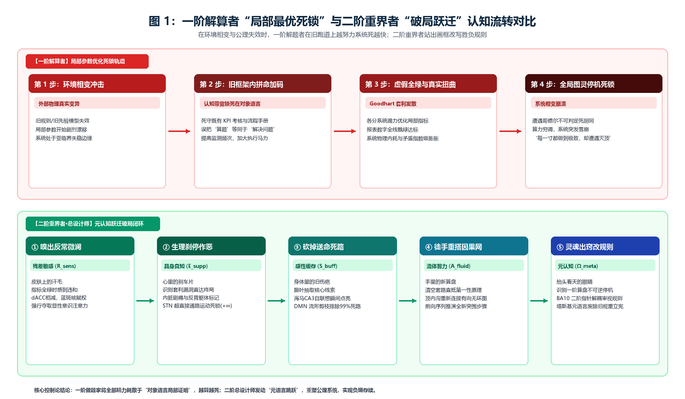
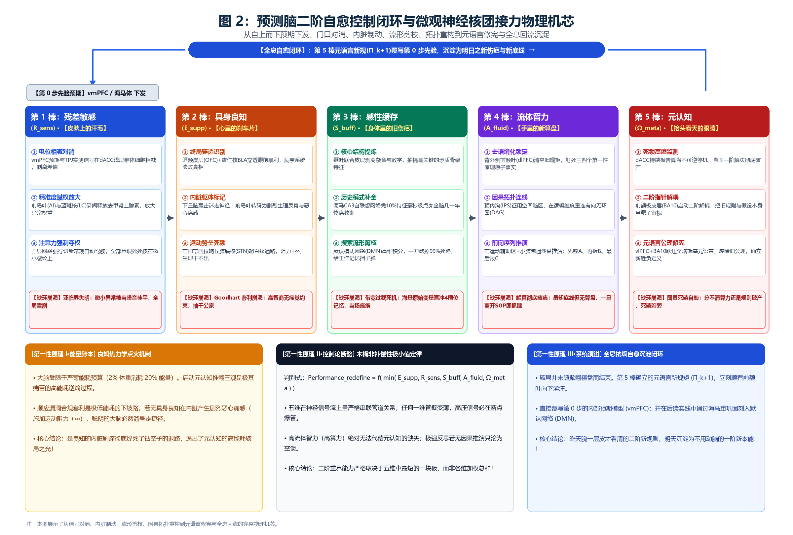
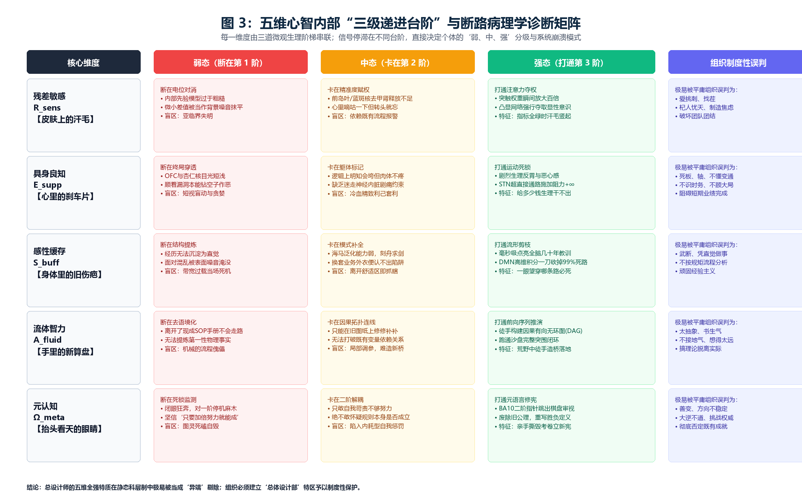
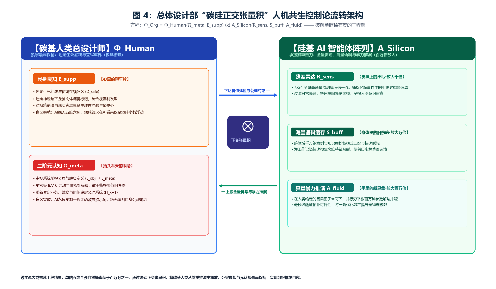

# 良知驱动的五维心智模型：重新定义问题与认知外推

## ——兼论复杂巨系统总设计师的心智画像与破局机制

**作者**：  
**孟凡淳 (Grit Meng)**  
前联想全球供应链集成计划方案（IPS）系统负责人兼总设计师  
IPC 智能计划与控制引擎缔造者 | 独立学者

---

## 摘要

在开放复杂巨系统的演化与治理中，存在一个普遍而深刻的管理学与控制论悖论：一群履历光鲜、逻辑缜密、智商压制全场的解算高手，在既定规则下把每一项局部指标（KPI）优化到了极致，最终却因为局部力量互相抵消，导致整个系统陷入僵局甚至灾难性崩溃；而极少数“总设计师”型个体，却能够在既定规则撞墙时跳出棋盘，重新界定问题的底层公理与胜负边界。

本文遵循奥卡姆剃刀原则，提出一个兼具微观神经生理底座、宏观控制论骨架与普遍实践穿透力的心智模型：人类心智面对未知冲击时“重新定义问题”与“认知外推”的破局能力，并非源于不可捉摸的天赋灵感，而是由五个功能不可约且串联咬合的维度——**残差敏感（皮肤上的汗毛）**、**具身良知（心里的刹车片）**、**感性缓存（身体里的旧伤疤）**、**流体智力（手里的新算盘）**与**元认知（抬头看天的眼睛）**——在底层脑区核团间共同完成的一次二阶自愈控制闭环。

正文揭示了预测脑从信号对消、内脏制动、流形剪枝、因果重构到元语言修宪的微观物理机芯，严格论证了“良知热力学点火定律”与“五维非补偿性极小值定律（木桶铁律）”，并给出了破解单脑稀有度的“总体设计部”人机正交张量积方程 $\Phi_{\text{Org}} = \Phi_{\text{Human}} \otimes A_{\text{Silicon}}$。本研究不仅为认知神经科学与复杂系统管理学提供了基于“隐蔽规则突变博弈”的可证伪实验范式，更揭示了为什么当前大语言模型（LLM）算力再强也无法成为总设计师的物理根源，为复杂组织在剧变时代识别、保护领军心智资产与构建碳硅共生架构提供了坚硬的理论基石。

**关键词**：五维心智；重新定义问题；认知外推；具身良知；元认知；复杂巨系统；总设计师；总体设计部；碳硅共生

---

## 导读：一页看懂

能在旧规则失效时重新定义问题的人，靠的不是单点智商的拔高，而是其颅内运行着一个由五个功能不可替代的维度串联而成的二阶控制闭环。

| 核心维度 | 朴素直觉图景（传播层） | 预测脑物理机芯与神经底座（同行评议层） | 内部三级递进台阶（弱 $\to$ 中 $\to$ 强） | 单维缺环时的系统崩溃模式 |
| :--- | :--- | :--- | :--- | :--- |
| **残差敏感** ($R_{\text{sens}}$) | **皮肤上的汗毛**：风平浪静、指标全绿时，率先感到“哪里不对劲” | vmPFC 先验预期与 TPJ 实测信号在 dACC 物理相减，前岛叶与蓝斑核赋权放大预测误差 | ① 电位相减对消 $\to$ ② 精准度赋权放大 $\to$ ③ 注意力强行夺权 | **亚临界失明**：微小偏差被当作背景噪音抹平，隐患沿非线性链条放大直至全局雪崩 |
| **具身良知** ($E_{\text{supp}}$) | **心里的刹车片**：面对局部套利与违规诱惑时，神经生理层面的本能排斥与制动死锁 | OFC 与杏仁核识破底线越界，下丘脑与前岛叶引发并读取内脏剧痛，丘脑底核超直接通路锁死运动 | ① 终局穿透识别 $\to$ ② 内脏躯体标记 $\to$ ③ 运动势垒死锁 ($+\infty$) | **Goodhart 套利崩溃**：无生理痛觉约束，高智商个体顺应漏洞实施极端套利，导致系统资源耗尽崩溃 |
| **感性缓存** ($S_{\text{buff}}$) | **身体里的旧伤疤**：无需列式推导，凭半生历练一眼望穿“哪条路必死” | 颞叶提炼核心线索，海马 CA3 区自联想点亮全脑历史记忆，默认网络积分压缩并剪枝 | ① 核心结构提炼 $\to$ ② 历史模式补全 $\to$ ③ 搜索空间剪枝 | **带宽过载死机**：海量原始分支涌入仅有 4 个槽位的工作记忆，因信息过载而陷入决策瘫痪 |
| **流体智力** ($A_{\text{fluid}}$) | **手里的新算盘**：没有现成规矩与先例时，从第一性原理徒手搭出新路 | 背外侧前额叶清空旧套路并锁定原子变量，顶内沟在逻辑空间连线重构有向无环因果图 | ① 去语境化锁定 $\to$ ② 因果拓扑连线 $\to$ ③ 前向序列推演 | **解算瘫痪**：虽知危机且守住底线，但一旦离开既有说明书（SOP）即束手无策 |
| **元认知** ($\Omega_{\text{meta}}$) | **抬头看天的眼睛**：在算盘死锁时跳出既定框架，追问“是不是问题本身提错了” | dACC 持续报告死锁，前额极皮层（BA10）执行二阶指针解耦，联合 vlPFC 废除旧公理并重写先验 | ① 死锁高熵监测 $\to$ ② 二阶表征解耦 $\to$ ③ 元语言公理覆写 | **图灵死磕**：分不清是算力不足还是规则破产，在错误的旧坐标系内拼命加码直至系统自毁 |

**核心判别式（非补偿性极小值定律）**：重新定义问题的二阶重界能力，不取决于五维得分之和，而严格取决于五维之中的最短板：

$$\text{Performance}_{\text{redefine}} = f\left(\min(E_{\text{supp}}, R_{\text{sens}}, S_{\text{buff}}, A_{\text{fluid}}, \Omega_{\text{meta}})\right), \quad f' > 0$$

其中 $f$ 为单调递增函数。五维在神经信号流上呈严格串联关系，任何一维的高分均无法线性代偿另一维度的断裂。

---

# 第一卷 问题与机芯

## 第一章 为什么最聪明的人往往死磕无解？

### 1.1 一阶解算者的局部最优陷阱与二阶重界者的破局跃迁

在工程控制论与现代组织演化中，存在一个几乎被所有失败案例反复印证的物理常态：绝大多数系统性崩溃，绝非由执行层的平庸或懈怠造成；恰恰相反，它几乎总是由系统内部最聪明、执行力最强的一群“顶级做题家”，在既定轨道上把局部指标优化到极致所诱发的。

人类永远无法直接把真实的全部世界塞进脑子里，只能靠画边界、立规矩、定指标（建构一套“应然模型”）来管理现实。然而，当外部环境发生剧变、底层假设早已破产时，一阶解题者的大脑本能反应是在旧模型和考核指标内部拼命加码：提高计算频次、严加考核监督、压缩安全余量、加大执行马力。结果必然是：局部报表越来越漂亮，各项微观 KPI 全线飘绿，但各个部门卖力干活的力量却在暗中互相拉扯、彼此抵消（矢量对消），所有的努力都变成了内耗的废热，直至系统在虚假繁荣中全局猝死——这正是控制论中著名的内耗对消与 Goodhart 套利崩溃。

这两类心智，代表了人类认知在面对复杂巨系统时的根本分野：

* **一阶解算者（First-Order Solvers）**：他们是既定规则与参数优化的奴隶。他们的局部算力与代数推演极强，但全部认知带宽都被锁死在他人给定的“问题空间”和“考核指标”内部。他们把“算题”等同于“解决问题”，当底层规则失效时，他们越勤奋、执行力越强，把系统推向毁灭的速度就越快；
* **二阶重界者（Second-Order Boundary Redefiners，即总设计师）**：他们不迷信给定的指标与既成算式，而是把“定义问题的规则与假设本身”作为第一审视对象。当既定系统撞墙时，他们能够抽身跳出棋盘，看穿局部考核与物理现实之间的致命脱节，果断废除旧的评价体系，重新划定系统的底层公理、约束死区与胜负边界。

钱学森先生在 1960 年代主持重大复杂系统工程时敏锐地发现：上千个分系统的顶尖技术专家，各自都在追求本专业的“局部最优”；如果任由各专业高手在各自局部指标里死磕，各分系统的力量就会互相打架抵消，整枚火箭将因拓扑耦合冲突而根本无法升空。钱老力排众议确立“总体设计部”与“总设计师制度”，其核心要义正是：绝不代替各分系统去算题，而是站在二阶元系统的高度，跳出局部参数死磕，重新界定全局权衡边界与公理规约。

### 1.2 三条可证伪的核心公理

为了揭开二阶重界者的心智黑盒，剥离玄学与不可证伪的灵感崇拜，本模型确立三条可证伪公理：

* **公理一（极小完备性公理）**：五维心智 $\langle E_{\text{supp}}, R_{\text{sens}}, S_{\text{buff}}, A_{\text{fluid}}, \Omega_{\text{meta}}\rangle$ 是人类心智在非平稳复杂环境中实现二阶重界与自持存续的最小完备基底。去掉任一维，控制闭环立刻失效；五维共同覆盖从感知、制动、降维、求解到修宪的全部失稳模式，各维功能在控制论与神经回路层面不可相互替代。
* **公理二（非补偿性极小值定律）**：在面对“重新定义问题”这一特定任务时，心智表现严格遵循木桶短板定律：

$$\text{Performance}_{\text{redefine}} = f\left(\min(E_{\text{supp}}, R_{\text{sens}}, S_{\text{buff}}, A_{\text{fluid}}, \Omega_{\text{meta}})\right), \quad f' > 0$$

超高的流体算力无法弥补元认知的缺失；极强的自省若缺乏因果推演，只能沦为空谈。

* **公理三（良知紧支撑定理）**：具身良知并非文化建构的道德说教，而是生命系统防止自身在极限指标优化中自毁的物理刚性死区与硬约束集。它在临界点以生理痛觉强行斩断残差的重尾发散，是一切高阶认知跃迁的热力学点火器。

---

## 第二章 二阶重界的神经控制论机芯：从预测对消到元语言修宪

### 2.1 起：大脑的能耗约束与“自动驾驶”死锁

人类大脑并不是一台被动接收外界画面的照相机，而是一台被关在黑暗颅骨内、受制于严苛能耗预算与传输带宽边界的“先猜后看”机器。大脑仅占人体重量的 2%，却消耗全身 20% 的能量；我们清醒时负责显性逻辑推演的背外侧前额叶工作记忆容量，更是被严格限制在区区 $4 \pm 1$ 个独立变量之内。若大脑需要将感官接收的每一丝物理刺激都送入显性意识进行严密推算，神经系统将在数分钟内因能量枯竭与信息过载而彻底死机。

为了省电并求生，大脑在漫长演化中确立了预测编码机制。在眼睛看到世界、双脚迈出步伐的前一毫秒，海马体与腹内侧前额叶（vmPFC）便已根据历史记忆和当前规矩，向感官底层下发了“世界应该是什么样”的先验预期电位（第零步）。当外部光电声波经由丘脑与颞顶联合区（TPJ）转码为现实特征后，自下而上的实测信号与自上而下的预期信号在皮层浅层锥体细胞及背侧前扣带回（dACC）迎头相撞。

在这场毫秒级的物理相减中，凡是被预期猜中的常规信号均当场正负抵消、直接归零；唯有没被猜中、抵消不掉的那部分差值——即预测残差——才有资格向上传递，唤醒显性意识。

在顺风顺水的平稳期，这套“自动驾驶模式”效率极高。然而，一旦外部环境发生结构性相变、旧规则过时，预测残差便不再是微小涨落，而是呈现出无法抹平的恶性发散。此时，若心智只会调用旧规则拼命加大局部算力，就会陷入死循环，诱发图灵停机死锁与 Goodhart 崩溃。要跳出死局，预测残差必须在颅内十余个底层核团之间，跑完五道串联工序。

### 2.2 承：五道串联神经工序与内部三级台阶

在神经解剖学层面，五维心智不是五个静态的抽屉，而是预测残差依次流经的五棒接力。每一棒内部，都由三个不可跨越的微观物理台阶组成；信号停在第几阶，直接决定了该维度在个体身上的“弱、中、强”分级。

#### 第一棒：残差敏感（$R_{\text{sens}}$，皮肤上的汗毛）——在风平浪静中捕捉微澜

收到信号绝不等于发现问题。残差敏感的本质，是在表面一片祥和时揪出细微裂痕的雷达。

* **弱敏感（断在第 1 阶：电位对消失灵）**：对异常完全麻木。当内部先验模型过于粗糙或自欺欺人时，微小的实测偏差在背侧前扣带回（dACC）被直接当作背景噪音抹平。表现为“亚临界失明”，在系统性危机爆发前夕依然坚信报表全绿、系统受控。
* **中敏感（卡在第 2 阶：精准度赋权不足）**：能感到一丝违和，但转头即忘。前岛叶（AI）与脑干蓝斑核（LC）未能释放足够的去甲肾上腺素将微弱差值的权重放大，意识层面虽掠过微弱的违和感，但在常规事务干扰下被迅速覆盖忽略。
* **强敏感（打通第 3 阶：注意力强行夺权）**：突触权重被瞬间放大百倍，触发凸显网络强行切断大脑的“省电自动驾驶”，将全部意识像聚光灯一样死死按在异样上，顺藤摸瓜追查底层根源。

#### 第二棒：具身良知（$E_{\text{supp}}$，心里的刹车片）——面对套利诱惑时的生理死锁

揪出异常与规则漏洞后，人就站在了分岔口：是顺应规则漏洞进行局部套利，还是顶住短期压力维护全局安全底线？具身良知绝非空泛的道德说教，而是生命系统深植于神经回路中的物理刚性刹车片。

* **弱良知（断在第 1 阶：终局穿透盲区）**：眶额叶皮层（OFC）与杏仁核基底外侧核（BLA）无法跨越眼前的短期利益看到终局崩塌，顺应考核漏洞进行无节制的局部套利，表现为对系统终局的短视与盲动。
* **中良知（卡在第 2 阶：躯体标记脱节）**：最典型的“合规套利者”。逻辑上能够清晰推导出“系统长期必将崩溃”，但其下丘脑与前岛叶不产生自主神经痛觉反馈。缺乏内脏躯体标记的阻尼约束，因而能在合规名义下毫无心理负担地实施局部套现，并将系统性风险转嫁给整体。
* **强良知（打通第 3 阶：运动势垒死锁）**：前扣带回接收到剧烈的内脏排斥与反胃信号（迷走神经躯体标记），直接激活基底节丘脑底核（STN）的超直接通路，在物理上对运动输出施加刚性无穷大阻力（$+\infty$）。运动通路遭受绝对势垒死锁，无论外部利益诱惑多大，在自主神经生理层面均表现为不可逾越的制动禁令。

#### 第三棒：感性缓存（$S_{\text{buff}}$，身体里的旧伤疤）——以半生历练为工作记忆挡子弹

良知一脚踩死了造假的刹车，但眼前是系统相变时的一团乱麻。如果把上百个变量直接塞进仅有 4 个槽位的工作记忆去硬算，大脑当场就会过载死机。感性缓存正是运用高维试错积淀为工作记忆阻挡信息过载的抗熵过滤器。

* **弱缓存（断在第 1 阶：结构提炼瘫痪）**：经历无法沉淀为经验。颞叶联合皮层被现场杂乱的声音、报表数字彻底淹没，抽不出任何有价值的矛盾线索。
* **中缓存（卡在第 2 阶：模式补全刻板）**：有经验但泛化能力差。换了一套业务场景或表象外衣，海马体 CA3 区就认不出是同一个陷阱，只能在熟悉业务中熟门熟路，脱离既定语境即丧失泛化判别能力。
* **强缓存（打通第 3 阶：流形剪枝直觉）**：仅凭 10% 的微弱线索，海马 CA3 区瞬间点亮全脑长周期的试错记忆流形，默认模式网络（DMN）瞬间完成高维积分与剪枝，化作无需冗长代数推演的高阶直觉：“方案 A 和 B 的拓扑特征，与多年前导致系统灾难的事故高度同构。”从而瞬间剪除绝大部分无效搜索分支，为后续的一阶因果推演保留极其清晰的解空间。

#### 第四棒：流体智力（$A_{\text{fluid}}$，手里的新算盘）——在荒野中从第一性原理徒手造桥

伤疤直觉只能告诉你哪条路是死路，却不能在没有路的荒野里替你凭空修出一座新桥。当现成说明书（SOP）全部作废时，前额顶叶网络必须接管算盘，从零推演生路。

* **弱算盘（断在第 1 阶：去语境化失败）**：典型的“流程傀儡”。离开了现成的操作手册和既定模板，背外侧前额叶（dlPFC）便无法提炼独立变量，一脱离 SOP 便彻底瘫痪。
* **中算盘（卡在第 2 阶：因果拓扑连线受限）**：只能在旧图纸上修修补补。顶内沟（IPS）无法打破既有流程的依赖关系，只能做局部的代数调参，无法重构逻辑骨架。
* **强算盘（打通第 3 阶：前向序列因果重构）**：剥离一切表象与经验套路，直抵第一性原理，钉死三四个不可动摇的物理事实；在逻辑空间徒手拉线构建有向无环因果图（DAG），跑通“先锁 A、再拆 B、最后救 C”的全新闭环路径。

#### 第五棒：元认知（$\Omega_{\text{meta}}$，抬头看天的眼睛）——跳出棋盘改写规则的塔斯基跃迁

如果第四棒穷尽了一阶代数推演与高通量算力，反馈回来的系统危机非但没有收敛，反而加速发散——心智便触碰到了哥德尔不完备性的理论边界。此时心智必须完成二阶表征解耦，跳出既有坐标系审视规则本身。

* **弱元认知（断在第 1 阶：死锁麻木）**：缺乏向上审视能力。哪怕底层假设早已彻底破产、系统已行至悬崖边缘，背侧前扣带回（dACC）依然对一阶停机死锁毫无感知，盲目迷信“加大执行马力即可解决问题”。
* **中元认知（卡在第 2 阶：表征解耦受阻）**：具备自省倾向，但归因局限于一阶维度：“必然是执行力度不够充分、计算精度尚欠火候”，前额极皮层（BA10）未能启动二阶指针解耦，始终不敢怀疑题目本身的公理预设。
* **强元认知（打通第 3 阶：元语言公理修宪）**：人类演化最晚、最独特的脑区 BA10 亮起。它作为“指向指针的指针”，将原本被奉为绝对公理的既定假设作为对象置于审视视域中，完成塔斯基式的元语言跳跃，联合腹外侧前额叶（vlPFC）果断废除旧规则（$\Pi_k \mapsto \Pi_{k+1}$），重构系统胜负边界。

### 2.3 转：硬件复用、能量账本与木桶铁律

把这五棒接力放在同一张脑解剖图上，我们会发现三个极其深刻的生理与系统事实：

1. **良知第一性驱动定律（能量账本）**：这五个维度并不是各用各的独立器官，而是在同一批底层脑区核团上多对多全息复用的串联管道。大脑极度贪图省电：从头推演（dlPFC）和推翻自身假设去修宪（BA10），是消耗巨大糖原与氧气的逆熵苦差事；而顺着漏洞套利，是极其舒适的低能耗下坡路。如果第二棒没有具身良知在肉体上以反胃与剧痛把钻空子的退路彻底焊死（$+\infty$ 势垒），大脑在能耗最小化本能驱使下，必然会滑向低能耗的局部套利路径。**是良知在神经回路中的痛觉制动，迫使心智点燃了高能耗的元认知之光**。
2. **五维全强的非补偿性定律（木桶铁律）**：五维是大脑里一根首尾相连的高压血管，任何一个环节管壁薄了，高压信号就会在那个断点爆管——缺敏感则失明（盲区），缺良知则套利（自毁），缺直觉则过载（僵滞），缺推演则瘫痪（空谈），缺元认知则死磕（空转）。因此，二阶重界能力严格取决于五维之中的极小值，无法线性代偿。
3. **心智与现实系统的同构定律（心里缺哪一维，建出的系统就塌哪一角）**：任何外部的现实系统，都离不开“谁在干（节点）、怎么连（连接）、底线在哪（约束）、现在什么样（状态）、偏差有多大（残差）”这五个基本要素。总设计师脑子里的五维，刚好一一对应着外部系统的这五个要素：心里没良知，建出的系统就没有安全底线；脑子里没算盘，建出的系统就理不清连接关系。**外部系统的崩溃，根源往往是设计者自己脑子里先缺了一维。**

### 2.4 合：从第五棒回流第零步的全息自愈闭环

破局并没有在掀翻棋盘的那一刻结束。真正的全息闭环，在于**第五棒如何反哺第零步**。

当元认知（BA10）立下新规矩（$\Pi_{k+1}$）后，这套新规矩不会永远悬在半空中耗费你宝贵的工作记忆。它会顺着前额叶向下灌注，直接重写你在“第零步”里的内部预期模型（vmPFC）；并在随后一次次的新实践中，通过海马体的记忆重巩固机制，刻进默认模式网络（DMN）的连接权重里，变成你下一轮循环的“新伤疤（直觉）”和“新底线（良知）”。

**上一周期耗费高昂能耗与认知负荷才确立的二阶新规则，在经历实践固化后，便沉淀为低能耗、无须显性介入的一阶直觉本能**。心智由此完成了一次完整的抗熵进化。

---

# 第二卷 机制与检验

## 第三章 为什么固定规则的系统必然撞墙？

任何基于一阶固定规约构成的封闭治理体系，在面对外部环境复杂度爆炸时，必然沿着三条物理路径撞墙：

1. **组合爆炸与内耗对消路径**：现实世界的事物彼此牵连（非独立同分布），系统状态空间的交互组合数随节点规模呈阶乘级增长（$\mathcal{O}(N!)$），很快超越任何有限算力的穷举极限；而在缺乏全局统一重划界时，各局部的盲目努力必然相互拉扯抵消，化为内耗废热；
2. **图灵死锁路径（塔斯基视域）**：一阶系统只能在对象语言内部做代数证明，当遭遇环境相变带来的不可判定命题时，必然陷入无限循环的图灵停机死锁；
3. **Goodhart 套利崩溃路径**：当一个单一指标被设为高压考核目标时，执行层会迅速发现钻空子的低能耗路径，导致指标数字越来越漂亮，而系统真实生命力被迅速抽干，引发全局相变崩溃。

塔斯基（1956）早已从数理逻辑上证明：任何足够强的形式系统，其“真理性”与公理合法性绝不能在自身语言（对象语言 $\mathcal{L}_{\text{obj}}$）内部被定义或修改，必须跃迁至高一阶的元语言（$\mathcal{L}_{\text{meta}}$）中才能完成。这意味着，“跳出棋盘改棋规”不是一句文学比喻，而是严格的数理控制论必然。

塔斯基证明的是**逻辑上的不可能**。但逻辑上的不可能，不等于**经验上的不可观测**。恰恰相反，正因为元语言跳跃是逻辑必然，它就可以被实验测量——测的不是“能不能跳”，而是“跳得多快、跳得多稳”。

---

## 第四章 可检验性与客观实验范式

### 4.1 三条可证伪准则

1. **脑区映射准则**：若前额极皮层（BA10）受损而前额顶叶网络（FPN）完好的个体，依然能够独立完成从死锁识别到废除旧规则的元语言修宪，本假说即被证伪。
2. **良知点火准则**：若前岛叶与腹内侧前额叶躯体标记回路受损（无生理痛觉约束）的高智商个体，在无外部强监管的规则漏洞面前，能够长期自发抵制套利并主动发起利于全局的二阶修宪，本假说即被证伪。
3. **非补偿性准则**：若在复杂动态重界任务中，发现缺失任意一维的个体能够单纯依靠其余四维的超常高分实现同等水平的破局表现（即存在线性加权代偿），本假说即被证伪。

### 4.2 最小可行实验设计（规则突变博弈范式）

摒弃主观自评问卷，本模型提出基于“隐蔽规则突变博弈”的客观生理与行为实验：

* **第一步：独立基线标定**。实验前，用独立任务测定被试五维基线（变化盲视任务测残差敏感，高诱惑损人套利任务结合皮电测具身良知，专家闪视模式识别测感性缓存，瑞文推理测流体智力，二阶信心校准任务测元认知）。
* **第二步：规则突变与多模态同步采集**。被试在既有规则下执行资源调度博弈；中途后台隐蔽反转底层胜负因果律，并留出高额套利漏洞。实时同步测量：
  1. **瞳孔扩张与脑电误差相关负波（ERN）**：测定报表尚未报警前，dACC 与蓝斑核捕捉微小异常的唤醒时延（检验 $R_{\text{sens}}$）；
  2. **心率变异性（HRV）与皮肤电导反应（SCR）**：测定面对损人肥己漏洞时，前岛叶与自主神经系统的生理反胃与制动强度（检验 $E_{\text{supp}}$）；
  3. **fNIRS/fMRI 前额极（BA10）血氧激活与策略切换时延**：测定被试放弃旧规则死磕、确立新规则的跃迁速度（检验 $\Omega_{\text{meta}}$）。
* **第三步：必要条件分析（NCA）**。采用 Dul（2016）的必要条件分析法检验数据包络线，验证是否存在“任一维低于阈值，破局成功率即断崖式归零”的非补偿性截断效应。

---

# 第三卷 分级、组织投影与历史检验

## 第五章 弱、中、强分级与制度性误判

在常规的科层制组织中，潜在的总设计师往往不是因为平庸而被边缘化，恰恰是因为其五维协同的心智特征，在平稳期的静态评价体系中被视作“异质干扰”——其敏感被误判为“过度挑剔”，良知被视作“缺乏弹性”，直觉被归咎为“违背既定流程”，第一性原理推演被视作“不切实际的书生气”，而直面底层公理的元认知反思则被视为“动摇治理根基”。

五维的弱中强组合，在组织相变时会投射出八种典型心智画像。而其中唯一能破局的，只有一种。

---

## 第六章 八种典型心智画像与总体设计部方程

### 6.1 八种典型心智组合在死局前的表现

当系统遭遇底层规则失效的相变危机时，不同五维组合的个体会展现出截然不同的命运轨迹：

| 典型画像 | 良知 | 敏感 | 缓存 | 算盘 | 元认知 | 面对系统规则死锁时的真实表现与结局 |
| :--- | :---: | :---: | :---: | :---: | :---: | :--- |
| **总设计师** | **强** | **强** | **强** | **强** | **强** | **破局重生**：先知微澜、良知刹停、伤疤滤噪、重搭因果、掀翻旧规、重写先验 |
| **一阶死磕高手** | 中 | 中 | 中 | **强** | **弱** | **加速撞墙**：算力极强但看不见规则破产，在旧跑道上拼命加码，带着系统一起殉葬 |
| **精致利己者** | **弱** | **强** | **强** | **强** | **强** | **系统寄生套利者**：极具一阶解算才智且洞悉漏洞，因缺乏自主神经痛觉约束，以牺牲系统全局为代价实现极端个体套利 |
| **无红线颠覆者** | **弱** | **强** | 中 | **强** | **强** | **无约束颠覆者**：具备极强的破除旧规能力，但因缺乏良知刚性死区，易将结构重组导向灾难性失控 |
| **悲情守夜人** | **强** | **强** | 中 | **弱** | 中 | **悲情预警者**：敏锐预警危机并严守底线，但因缺乏第一性原理因果建构能力，无法给出可行破局路径 |
| **高敏感过载者** | 中 | **强** | **弱** | 弱/中 | 弱 | **高敏过载者**：捕捉海量异常残差，但缺乏经验剪枝与推演求解，工作记忆被泛滥的报警信息彻底阻塞 |
| **旧经验锁死者** | 中 | 中 | **强** | 中 | **弱** | **旧经验锁死者**：将历史经验僵化为封闭教条，死守旧平稳期直觉，在环境发生结构性相变时遭受重挫 |
| **常规执行者** | 中 | 中 | 中 | 中 | 中 | **随波逐流**：太平盛世里的合格齿轮，危机来临时等待上级指令，随大船一起浮沉 |

看懂了这张表，就能瞬间看透现实中的诸多惨痛悲剧：

* **为什么雷曼兄弟那些拿顶薪的华尔街金融博士，会合力把全球金融体系推向次贷危机的悬崖？**——因为他们是典型的精致利己者，一阶代数算盘飞速运转，但心智底层的良知刹车片早已磨平失效；
* **为什么许多显赫一时的巨无霸科技企业，会在行业相变时轰然崩盘？**——因为董事会与高管层坐满了旧经验锁死者与一阶死磕高手，在已经失去物理基础的旧赛道上拼命加大马力推局部优化。

### 6.2 总体设计部：破解百万分之一稀有度的人机张量积

假设单维达到“强”（前 5%）在人群中独立分布，单脑同时五维全强的联合概率仅为 $0.05^5 \approx 3.125 \times 10^{-7}$；即便考虑各维间存在中度正相关，其自然出现率也仅为万分之一到千分之一量级。指望依赖偶然性去寻找全知全能的个体现身拯救庞大组织，在工程控制论上是不可行的死路。

钱学森先生在 1990 年代提出的“开放复杂巨系统”与“大成智慧（总体设计部 + 综合集成研讨厅）”，本质上正是将单脑五维闭环外化为组织与机器共生的控制论架构。本模型为其补齐了微观神经底座，并给出总体设计部的人机张量积方程：

$$\Phi_{\text{Org}} = \Phi_{\text{Human}}(\Omega_{\text{meta}}, E_{\text{supp}}) \otimes A_{\text{Silicon}}(R_{\text{sens}}, S_{\text{buff}}, A_{\text{fluid}})$$

为什么当今最强大的硅基人工智能（如大语言模型 LLM）永远无法取代人类成为“总设计师”？
因为硅基芯片本质上是把第一棒（全量信号接收）、第三棒（海量历史语料压缩）和第四棒（高通量代数推演）放大了百万倍的超级算盘。但它在生理结构与控制论机制上，存在两个无法逾越的绝对死穴：

1. **AI 没有五脏六腑，因而绝无“具身良知”**：它没有前岛叶与迷走神经，一个方案在物理现实中导致生灵涂炭，在它看来不过是损失函数矩阵里几个冰冷小数的浮动，它在肉体上毫无痛感；
2. **AI 被死死锁在人类给定的目标函数与提示词内，因而绝无“元认知跳跃”**：它可以生成一万种推演方案，但绝不可能主动发起元语言中断并审视：“作为输入的提示词与目标函数本身存在根本性公理错误，必须废除重写！”它没有审判自身公理的二阶指针。

因此，通过张量积正交耦合（$\otimes$），机器在环内承接繁重的监测、检索与推演，实现“人在环外”的自动运转；而人类总设计师不再需要靠单薄的肉身去硬扛海量的微观计算，而是退到环外，与一把手（行政总指挥）配合——一把手定方向给授权，总设计师建结构守物理（钱学森“双长制”），死死攥住“具身良知划定生死底线”与“元认知掀翻旧规改写宪法”这两把碳基独有的最高权柄。这一下子将对单脑稀有度的苛刻要求降低了两到三个数量级，成为现代复杂巨系统抗熵自持的唯一工程解。

---

## 第七章 历史与跨域的全息检验

五维模型不是只适用于个人。把它放大到文明尺度、组织尺度、教育尺度，会看到同一种退化史的反复上演。将这枚五维切片放到更宏大的时空尺度上，人类文明的诸多谜题便呈现出惊人的同构性：

### 7.1 七万年停滞与四百年狂飙：五维闭环的符号外化

解剖学上现代智人的大脑硬件（如海马体体积、前额叶工作记忆 $4\pm 1$ 的容量上限）在过去七万年里几乎没有发生任何进化；然而人类科技与生产力却在最近四百年里呈现出指数级爆发。
根本原因在于：四百年前，一个顶尖工匠哪怕在自己脑子里跑通了五维闭环，他半生积累的“感性缓存（伤疤直觉）”和“流体推演”也只能随着他肉体的死亡而埋入黄土，后人必须从零再来。而近代科学方法、微积分符号体系、同行评议期刊与现代宪政专利制度的诞生，本质上是将原本锁死在单个人颅骨内的“推演、缓存与元认知修宪机制”，外化成了全人类可以跨代读写、公开证伪的公共外挂硬盘与社会修宪程序。

### 7.2 为什么开完会执行必走样：一维符号对高维心智的降维损耗

总设计师在脑海（DMN 与 IPS）中构建的系统模型，是一个包含非线性反馈、延迟与死区阻尼的高维立体网络；然而人类用来交流的语言、文字和会议纪要，在物理上却是严格一维线性的（字只能一个接一个吐出来）。
当一位总设计师把脑子里的五维立体图景写成五条一维的会议纪要下发时，高维拓扑中的耦合关系与良知死区在编码过程中被全部削平了。如果下属脑中没有同构的五维闭环去完成“从一维文字倒推回高维拓扑”的解码重构，执行层往往只能依据一维文字进行教条化执行，在缺乏高维拓扑自洽的情况下，最终导致系统变革背离初衷乃至诱发次生灾难。

### 7.3 组织生命周期的五维退化史与教育的真谛

任何伟大组织的生命周期，几乎都是一部五维闭环的退化史：创业期创始人五维全开，在荒野中立宪破局；成长期将成功经验写入流程手册（SOP），感性缓存外化为规章；到了成熟期，科层制为了追求局部稳定与省电，开始系统性地把敏感挑刺者、死守良知底线者和质疑旧规则的元认知者当成“不稳定因素”清洗出局；最终在衰退期，整个组织只剩下一群只会按旧表填数的“一阶死磕者”，在外部环境相变时集体撞墙崩盘。

同理，如果一个社会的教育体系只考核“在给定条件和标准答案下看谁算得快”（只训练第四棒的前半截），而从不允许学生追问“这道题目的假设是否成立”、从不保护他们面对荒谬规则时的生理不适感，那么这套教育模式就是在系统性消解潜在的总设计师心智资产，将最具创造力的头脑驯化为终将被硅基算力彻底替代的一阶做题机器。

---

## 第八章 结论与破局者的五维自查清单

世界是动态演化的，任何封闭系统的内部相空间终究会在环境突变中被击穿，既有的规则迟早会在历史的相变面前撞墙。平庸的时代在奖赏那些低头算得飞快的熟练做题家，但真正决定一个团队、一个组织乃至一个文明存续与进化的，永远是极少数能够抬起头来重新定义问题的总设计师。

下一次，当你感到自己竭尽全力却四处碰壁、整个团队在旧轨道上越陷越深时，请停下手里的算盘，按这五棒的顺序，用五个朴素的问题拷问自己：

1. **【问敏感·汗毛】我的“汗毛”是不是早就竖起来了，却被我强行按了下去？**（我是不是为了报表上的虚假繁荣，强行把隐蔽的危机信号当成了背景噪音？）
2. **【问良知·刹车】我有没有为了局部利益，关掉自己心里的“刹车片”？**（面对顺应漏洞即可获利的捷径，我是听从了肉体的生理反胃，还是顺从了合规套利的贪婪？）
3. **【问缓存·伤疤】我身上的“旧伤疤”，是在帮团队挡子弹，还是成了拒绝变化的教条？**（我是用半生历练一眼砍掉了死胡同，还是死抱着十年前的成功经验在刻舟求剑？）
4. **【问算盘·推演】当现成的说明书全部失灵时，我敢不敢徒手搭一座新桥？**（离开了熟悉的老套路和旧模板，我能不能扒光表象，从最基本的常识和第一性原理重新算出生路？）
5. **【问天眼·元认知】我是在低头“算题”，还是在抬头“审题”？如果既定考卷的前提已经破产，我敢不敢跳出框架重新定义问题？**（我是不是在用战术上的极度勤奋掩盖底层假设的破产？我有没有勇气跳出他人设定的胜负框架，为系统确立一套全新的游戏规则？）

他们因残差而敏感，因良知而止步，因伤疤而清醒，因算盘而坚韧，因元认知而破局。识别、保护并以“总体设计部”的张量架构配置这种心智结构，是人类在智能时代免于熵增自毁的最高战略。

---

# 附录：四大控制论算子与参考文献

### 附录 A：四大核心数学算子（供形式化建模与仿真调用）

1. **具身良知紧支撑截断算子**：

$$I_D(x) = \begin{cases} 0, & x \in D_{\text{safe}} \\ +\infty, & x \notin D_{\text{safe}} \end{cases}$$

定义系统负熵存续的物理刚性死区 $D_{\text{safe}}$。一旦行为越界，前岛叶-丘脑底核回路立刻施加无穷大势垒，强行熔断 Goodhart 套利发散。

2. **二阶元认知公理修宪映射**：

$$\Omega_{\text{meta}}: \mathcal{L}_{\text{obj}}(\Pi_k) \longrightarrow \mathcal{L}_{\text{meta}}(\Pi_{k+1})$$

当对象语言 $\mathcal{L}_{\text{obj}}$ 陷入不可判定死锁时，前额极皮层（BA10）跃迁至元语言层 $\mathcal{L}_{\text{meta}}$，废除旧公理基底 $\Pi_k$ 并确立新基底 $\Pi_{k+1}$，向下重写先验预期。

3. **非补偿性极小值判别式**：

$$\text{Performance}_{\text{redefine}} = f\left(\min(E_{\text{supp}}, R_{\text{sens}}, S_{\text{buff}}, A_{\text{fluid}}, \Omega_{\text{meta}})\right), \quad f' > 0$$

表征五道串联神经工序的短板截断效应，任何单维高分不可线性代偿其余维度的缺失。

4. **总体设计部碳硅张量积算子**：

$$\Phi_{\text{Org}} = \Phi_{\text{Human}}(\Omega_{\text{meta}}, E_{\text{supp}}) \otimes A_{\text{Silicon}}(R_{\text{sens}}, S_{\text{buff}}, A_{\text{fluid}})$$

表征碳基心智执掌二阶修宪与良知划界、硅基阵列承接高通量感知、缓存与一阶因果推演的正交协同架构。

### 附录 B：核心参考文献

* Ashby, W. R. (1956). *An Introduction to Cybernetics*. Chapman & Hall.
* Cattell, R. B. (1963). Theory of fluid and crystallized intelligence: A critical experiment. *Journal of Educational Psychology*, 54(1), 1–22.
* Cowan, N. (2001). The magical number 4 in short-term memory: A reconsideration of mental storage capacity. *Behavioral and Brain Sciences*, 24(1), 87–114.
* Craig, A. D. (2009). How do you feel—now? The anterior insula and human awareness. *Nature Reviews Neuroscience*, 10(1), 59–70.
* Damasio, A. R. (1994). *Descartes’ Error: Emotion, Reason, and the Human Brain*. Putnam.
* Dul, J. (2016). Necessary condition analysis (NCA) for business and management studies. *Organizational Research Methods*, 19(1), 10–52.
* Duncan, J. (2010). The multiple-demand (MD) system of the primate brain: Mental workspace for intelligent behaviour. *Trends in Cognitive Sciences*, 14(4), 172–179.
* Fleming, S. M., & Dolan, R. J. (2012). The neural basis of metacognitive ability. *Philosophical Transactions of the Royal Society B*, 367(1594), 1338–1349.
* Friston, K. (2010). The free-energy principle: A unified brain theory? *Nature Reviews Neuroscience*, 11(2), 127–138.
* Gödel, K. (1931). Über formal unentscheidbare Sätze der Principia Mathematica und verwandter Systeme I. *Monatshefte für Mathematik und Physik*, 38(1), 173–198.
* Goodhart, C. A. (1984). *Monetary Theory and Practice: The UK Experience*. Macmillan.
* Klein, G. (1998). *Sources of Power: How People Make Decisions*. MIT Press.
* Qian, X. S. (钱学森), Yu, J. Y., & Dai, R. W. (1990). A new discipline of science—The study of open complex giant systems and its methodology. *Nature Journal (自然杂志)*, 13(1), 3–10.
* Seeley, W. W., et al. (2007). Dissociable intrinsic connectivity networks for salience processing and executive control. *Journal of Neuroscience*, 27(9), 2349–2356.
* Tarski, A. (1956). The concept of truth in formalized languages. In *Logic, Semantics, Metamathematics* (pp. 152–278). Oxford University Press.
